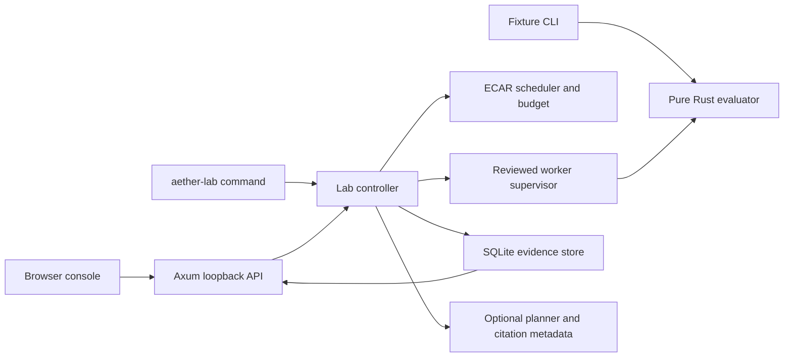

# AETHER codebase tour

Start with one calculation, follow the same trust boundary into a complete campaign, and finish by tracing a UI request back to the experiment. Use the [rebuild curriculum](docs/learning/REBUILD_AETHER_FROM_SCRATCH.md) to implement small versions in a separate practice workspace.

The repository is a modular Rust workspace with two entry points and a React/TypeScript browser client. With one local writer and one local observer, begin by reading the state transitions and evidence records. That makes it easier to distinguish an observation, a policy decision and a verified claim.

## Walk one fixed experiment

1. Open `evaluate` and `fixture` in [aether-core](crates/aether-core/src/lib.rs). Match the four literal predictions against their labels and predict the exact counts before running a test.
2. Follow argument dispatch in [aether CLI main](crates/aether-cli/src/main.rs) to `run_fixture` in [native.rs](crates/aether-cli/src/native.rs). Two identifiers have different jobs. The run ID locates a digest reference. The digest locates and checks the immutable bytes.
3. In `read_and_replay`, follow digest check → typed identity check → exact metric recomputation. See the [fixture acceptance tests](crates/aether-cli/tests/native_fixture.rs) for examples of tampering and replay. [Rust and evaluator lesson](docs/learning/IMPLEMENTATION_RUST_EVALUATOR.md).

## Walk one reviewed campaign

4. Start at `execute` in [aether-lab main](crates/aether-api/src/main.rs). The `plan`, `approve`, and `run` commands expose separate steps. The canned `demo` uses one bounded built-in example and its digest.
5. In [lab.rs](crates/aether-api/src/lab.rs), read `Lab::create`, `Lab::approve`, and `Lab::run_approved`. Find the point that binds the plan to the exact protocol bytes and the point that logs a scheduler decision before dispatch.
6. Read `schedule_with_trace` and `score` in [scheduler.rs](crates/aether-engine/src/scheduler.rs). Follow the commitment through `try_reserve` and `settle` in [budget.rs](crates/aether-engine/src/budget.rs). The persistent check lives in `start_attempt_with_reserve` and `complete_attempt` in the [attempt store](crates/aether-store/src/execution.rs). [Scheduling and statistics lesson](docs/learning/IMPLEMENTATION_ECAR_STATISTICS.md).
7. In [aether-runner](crates/aether-runner/src/lib.rs), follow `supervise` → `supervise_child` → `execute_worker`. Then read `evaluate`, which compares against a trusted reference. The worker is reviewed native code executed by the same platform executable in a separate OS process. [Processes and security lesson](docs/learning/IMPLEMENTATION_OS_SECURITY.md).
8. In [evidence.rs](crates/aether-store/src/evidence.rs), read `link_evidence`, `record_replication`, `record_verification`, and `revoke`. Inspect a report and identify what distinguishes an independently replayed observation from a claim state. [Storage and graph lesson](docs/learning/IMPLEMENTATION_STORAGE_GRAPHS.md).

## Walk one interaction and test its boundary

9. Start at `App` in the [React console](web/src/App.tsx). `request` and `getSnapshot` in the [API client](web/src/api.ts) use a same-origin endpoint and in-memory bearer token. `EvidenceGraph` in [campaign views](web/src/campaignViews.tsx) renders meaning already present in the snapshot.
10. Follow the request into `serve` and `authorize` in [http.rs](crates/aether-api/src/http.rs), then compare `detail`, `start`, `cancel`, and `live`. The console refreshes snapshots. The server also provides cursor-based event reads and an SSE stream.
11. Inspect `propose_recorded` in [planning.rs](crates/aether-api/src/planning.rs) and `search_metadata` in [literature discovery](crates/aether-api/src/literature/discovery.rs). Optional providers suggest reviewed sort choices or return bibliographic metadata. They have no authority to run a task or assign a verdict. [API and agents lesson](docs/learning/IMPLEMENTATION_API_AGENTS.md).
12. Compare `benchmark` and `benchmark_native` in [main.rs](crates/aether-api/src/main.rs). The first runs matched synthetic policies. The second times real native process startup and sorting under its stated scope. GPU and remote worker work has independent gates. [Compute lesson](docs/learning/IMPLEMENTATION_COMPUTE_DISTRIBUTED.md).

## Walk Prometheus in source order

13. Read `PlanRequest::optimization_inputs` and `Lab::run_approved` in the [controller](crates/aether-api/src/lab.rs). Then compare `solve` and `compare` in the [optimization worker](crates/aether-runner/src/optimization.rs). Trace how a rejected baseline becomes contradictory evidence.
14. In [evolution.rs](crates/aether-engine/src/evolution.rs), follow `evolve`, `search`, `check`, and `exhaustive_optimum`. Read the candidate parent and evaluation costs before checking the final regret. Reordering search attempts and repeating a problem are different concepts.
15. Compare read-side `snapshot` in [read.rs](crates/aether-store/src/read.rs) and batch draining in [http.rs](crates/aether-api/src/http.rs). Session state, claims and journal are consistent at one read snapshot. Stream delivery uses the committed sequence.
16. Trace `gpu_snapshot` in [hardware.rs](crates/aether-api/src/hardware.rs) and `GpuTelemetry` in [console views](web/src/consoleViews.tsx). Check how missing readings show up in the UI. Compare driver memory with separately measured inference capability. [Prometheus practice](docs/learning/IMPLEMENTATION_PROMETHEUS.md)

## Walk Athena from proposal to evidence

17. Follow `plan_objective` in [main.rs](crates/aether-api/src/main.rs), then `Lab::freeze_citations`, `Lab::existing_objective_draft` and `Lab::create_objective_draft` in [lab.rs](crates/aether-api/src/lab.rs). These paths link selected metadata and validated advice to immutable protocol bytes. Read `Lab::approve` to find the boundary between the local model's proposal and a trusted action. The [recorded Athena draft](research/results/athena-local-draft-report.json) was prepared for exact owner approval.
18. Read `OllamaModel::rank` in [providers.rs](crates/aether-api/src/planning/providers.rs), then `local_server` and `measured_trial` in the [inference harness](scripts/athena_ollama.py). Trace the checks that establish local inference and the counters that distinguish cold load, time to first text and generation throughput.
19. Follow `supervise_child` in the [runner](crates/aether-runner/src/lib.rs) to `spawn` and `wait_for_admission` in [windows_worker.rs](crates/aether-runner/src/windows_worker.rs). Check when the child begins work and how Job Object cleanup affects its process tree. The reviewed execution boundary still depends on the current host identity and access policies.
20. Trace `draw` and `run` in the [ECAR diagnostic](crates/aether-engine/examples/ecar_diagnostics.rs) into `contrast` in the [paired summary](scripts/athena_ecar_summary.py). Compare host scheduler timing, simulated costs and measured [loopback percentiles](tests/measure-loopback.cjs). [Athena practice](docs/learning/IMPLEMENTATION_ATHENA.md)

## Run the checks

From the repository root use `cargo test --locked --workspace`, `cargo fmt --all -- --check`, and `cargo clippy --locked --workspace --all-targets -- -D warnings`. Run `npm run build` from [web](web/README.md) after dependencies are present. Match the toolchain and job commands in [CI](.github/workflows/ci.yml). The [platform integration tests](crates/aether-api/tests/platform.rs) exercise real application entry points. Follow [project status](PROJECT_STATUS.md) for actual test results and available features.
