<p align="center">
  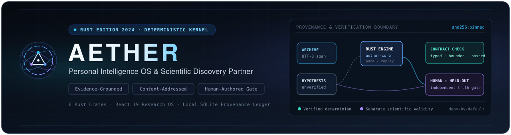
</p>

<h1 align="center">AETHER</h1>

<p align="center">
  <strong>An evidence-grounded Rust intelligence platform built for reproducible scientific discovery.</strong>
</p>

<p align="center">
  AETHER is a local-first research engineering system that turns literature passages, knowledge graphs, bounded task runs, and immutable SHA-256 artifacts into auditable evidence chains — while keeping structural verification strictly separated from empirical truth.
</p>

<p align="center">
  <a href="https://github.com/akaKRISH/AETHER/actions/workflows/ci.yml"></a>
  
  
  
  
  
  <a href="LICENSE_DECISION.md"></a>
</p>

<p align="center">
  <a href="#overview">Overview</a> ·
  <a href="#architecture">Architecture</a> ·
  <a href="#research-lifecycle">Research Lifecycle</a> ·
  <a href="#core-systems">Core Systems</a> ·
  <a href="#evidence-and-provenance">Evidence &amp; Provenance</a> ·
  <a href="#apo-11">APO-11</a> ·
  <a href="#screenshots">Screenshots</a> ·
  <a href="#quick-start">Quick Start</a> ·
  <a href="#security">Security</a> ·
  <a href="#roadmap">Roadmap</a> ·
  <a href="#documentation">Documentation</a>
</p>

---

> [!IMPORTANT]
> **Implemented vs. Deferred Scope:**
> - **Implemented on `main`:** Core deterministic Rust workspace (`aether-core`, `aether-engine`, `aether-store`, `aether-runner`, `aether-cli`, `aether-api`), literature archive & byte-span knowledge graph (`APO-01`–`04`), local model & dev dataset labs (`APO-05`/`06B`), declarative skills & DAG workflows (`APO-07`–`10`), local Research OS SPA (`web/`), **APO-11 structural evaluation backend ([PR #2](https://github.com/akaKRISH/AETHER/pull/2))**, and the **4-area Research Quality Evaluation workspace ([PR #1](https://github.com/akaKRISH/AETHER/pull/1))**.
> - **Deferred / Not Implemented:** Live adapter training (`APO-06C–F`), automated multi-agent runtime daemons, human-review write endpoints (`not_evaluated`), and independent held-out scientific validation (`not_performed`). No public hosted demo exists; AETHER runs locally on loopback `127.0.0.1`.

---

## Overview

Most AI research prototypes conflate fluent generation with valid evidence: prompts mutate, negative results vanish, models score their own outputs, and ambient host permissions blur the line between a hypothesis and a verified computation.

**AETHER** (*Autonomous Research and Engineering Laboratory*) takes the opposite architectural stance: **intelligence only earns trust through inspectable provenance and bounded execution.**

- **Deterministic Rust Domain Ownership (`Rust Edition 2024`):** All campaign transitions, budget accounting, protocol verification, and scoring live in pure, deterministic Rust (`aether-core` carries zero external dependencies and `#![forbid(unsafe_code)]`), never inside model outputs or frontend state.
- **Immutable Provenance Before Claims:** Source passages, SHA-256 artifacts, contradictions, hypotheses, and experiment designs are persisted in SQLite (`aether-store`) with byte-offset traceability so failures remain first-class evidence.
- **Zero Self-Grading:** Candidate proposers and worker processes can propose artifacts and run bounded computations, but only an isolated, trusted evaluation pathway — plus independent replay and human approval — can establish verification.

---

## Core Systems

What AETHER executes and verifies today on `main` versus what remains open in review or deferred:

| Domain | Current Capability on `main` | Hard Boundaries & Provenance State |
|---|---|---|
| **Domain Kernel & State** | Pure state machines (`DRAFT → APPROVED → RUNNING → COMPLETED`), integer budgets, deterministic metrics ([`aether-core`](crates/aether-core/README.md)) | Zero external crate dependencies; `#![forbid(unsafe_code)]`; deterministic offline execution |
| **SQLite & Artifact Store** | Schema migrations (`001_initial.sql`), SHA-256 SQLite BLOBs, atomic completion transactions ([`aether-store`](crates/aether-store/README.md)) | Trusted local controller boundary; digest mismatches fail closed on read |
| **Bounded Worker Runner** | Reviewed sorting & optimization harnesses, output size limits (`MAX_OUTPUT`), OS containment ([`aether-runner`](crates/aether-runner/README.md)) | Windows Job Objects (`win32job`), Linux containment checks; 9 containment tests ignored in default workspace run and invoked separately |
| **Native Fixture CLI** | Standalone `aether` CLI (`init`, `run-fixture`, `verify`, `report`) with atomic hard-link run publishing ([`aether-cli`](crates/aether-cli/README.md)) | Fixed `classification-v1` teaching fixture (`3/4`, `0.75`); no network or LLM dependency |
| **Literature Archive** | Bounded Crossref, OpenAlex, and arXiv fixture parsing; UTF-8 text ingest with exact byte offsets (`APO-01`) | Anonymous inspection denied; untrusted prompt-like instructions retained as inert quoted bytes |
| **Knowledge Graph** | Persistent SQLite entity/link revisions (`supports`, `contradicts`, `depends_on`), 2-hop SHA-256 export (`APO-02`) | Contradictions preserved; source group hashing prevents double-counting duplicates |
| **Hypotheses & Design** | DAE-04 20-case slice indexing, advisory hypothesis ranking, 3 exploratory experiment drafts (`APO-03`/`04`) | Ranked proposals stay `unverified`; drafts lack statistical power estimation and are unapproved |
| **Local Models & Datasets** | Local GGUF/SafeTensors inspection, Ollama loopback gate (`APO-05`), group-disjoint dev dataset splits (`APO-06B`) | `independent_test: external_custody_required`; LoRA/QLoRA live training (`APO-06C–F`) blocked/deferred |
| **Skills & Workflows** | Versioned inert skills (`APO-07`), closed Rust operation allowlist (`APO-09`), sequential DAGs (`APO-08`), 9+7 fixture eval (`APO-10`) | Zero shell, Python, or network execution in skills; cooperative cancellation only |
| **Research OS Web UI** | React 19 + TypeScript SPA over loopback bearer-token Axum API & SSE (`web/`, `DAE-08`) | Binds strictly to `127.0.0.1`; constant-time auth; 8 KiB body cap |
| **APO-11 Evaluation** | **Backend & UI merged on `main` ([PR #2](https://github.com/akaKRISH/AETHER/pull/2), [PR #1](https://github.com/akaKRISH/AETHER/pull/1)):** Draft 2020-12 contract, 8 structural rules, `/v1/eval/*` API, and 4-area Research Quality Evaluation UI | Structural completeness & arithmetic checks only; `human_review: not_evaluated`; `independent_scientific_validation: not_performed` |

---

## Architecture

AETHER is structured as a strict six-crate Rust Edition 2024 workspace (`resolver = "3"`, `publish = false`) backing a loopback Axum API server and a React 19 / TypeScript single-page console.

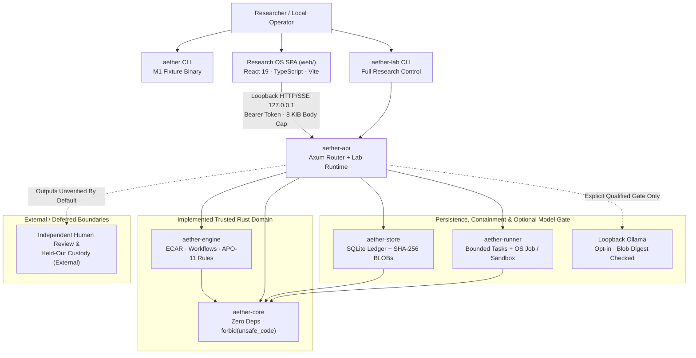

<details>
<summary><strong>Crate map, pinned stack versions, and repository layout</strong></summary>

| Component | Path | Internal Deps | Responsibility |
|---|---|---|---|
| `aether-core` | [`crates/aether-core`](crates/aether-core/README.md) | *None* | Pure protocol types, IDs, integer budgets, state machines, pure ranking & metrics |
| `aether-engine` | [`crates/aether-engine`](crates/aether-engine/README.md) | `aether-core` | ECAR simulation, scheduling trace, recovery, APO-11 structural evaluator |
| `aether-store` | [`crates/aether-store`](crates/aether-store/README.md) | `aether-core`, `aether-engine` | Bundled SQLite migrations (`001_initial.sql`), SHA-256 BLOBs, atomic campaign events |
| `aether-runner` | [`crates/aether-runner`](crates/aether-runner/README.md) | `aether-core`, `aether-engine` | Reviewed sorting/optimization task workers, output bounds, OS containment adapter |
| `aether-cli` | [`crates/aether-cli`](crates/aether-cli/README.md) | `core`, `engine`, `store`, `runner` | Standalone native M1 fixture binary (`aether`) |
| `aether-api` | [`crates/aether-api`](crates/aether-api/README.md) | `core`, `engine`, `store`, `runner` | `#![forbid(unsafe_code)]`; `aether-lab` CLI & Axum loopback HTTP/SSE server |
| `web/` | [`web/package.json`](web/package.json) | `/v1` JSON + SSE API | React `^19.3.1`, TypeScript `~5.9.3`, Vite `~7.3.8`, Biome `2.6.9`, Playwright `1.65.1` |

**Verified Dependency Pins:** Rust `1.96.1` (Edition 2024) · `axum 0.8` · `tokio 1` · `rusqlite 0.43` (`bundled`) · `sha2 0.10` · `serde 1` · `thiserror 2` · `roxmltree 0.21` · `ureq 3.5` · `win32job =2.0.3` · `windows =0.61.3` · `criterion 0.8.2` *(dev)* · Node `>=22.12.0` (CI `24`). See [`Cargo.toml`](Cargo.toml) and [`.github/workflows/ci.yml`](.github/workflows/ci.yml).

```text
AETHER/
├── .github/workflows/ci.yml      # GitHub Actions CI: Rust (Windows + Ubuntu) & Web
├── Cargo.toml / Cargo.lock       # Rust Edition 2024 workspace (6 crates, resolver 3)
├── crates/                       # aether-{core,engine,store,runner,cli,api}
├── contracts/                    # Draft schemas, examples & canonical apo11/ contract
├── web/                          # React 19 + TypeScript Research OS console
├── benchmarks/                   # Athena & Prometheus pinned benchmark definitions
├── research/                     # Curated literature & immutable research/results/
├── docs/
│   ├── assets/                   # Custom hero banner, mark SVG & Research OS screenshots
│   ├── archive/                  # Byte-frozen Genesis, v0.1 & v0.2 archives (SHA256SUMS)
│   ├── architecture/             # System, component, state-machine & worker specs
│   ├── decisions/                # ADR-001 through ADR-023 architectural records
│   ├── diagrams/                 # 21 Mermaid sources + rendered SVGs
│   ├── engineering/              # Coding standards, concurrency & Prometheus audit
│   ├── governance/               # Human approval, research integrity & license status
│   ├── security/                 # Threat model, sandbox, secrets & incident response
│   ├── testing/                  # Test plan, quality gates, results & traceability
│   └── agent-handoff/            # Shared ledger & per-agent development journals
├── scripts/                      # Startup scripts, doc validator & APO-11 validator
└── tests/                        # End-to-end Playwright browser smoke suite
```

</details>

---

## Research Lifecycle

AETHER connects literature acquisition through reproducible workflow evaluation using hash-pinned transitions at every boundary. Downstream steps never silently promote upstream source confidence.

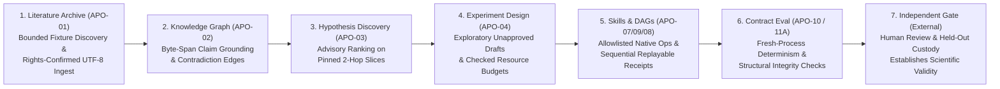

<details>
<summary><strong>Milestone progression and key CLI journeys (Phase 0 through APO-11)</strong></summary>

| Milestone | Status on `main` | Key Verified Deliverable |
|---|---|---|
| **Phase 0 / M1 Foundation** | Complete | Genesis archives frozen (`102` fingerprinted files), 6-crate workspace, native `aether` fixture CLI (`0.75` exact classification) |
| **Prometheus & Athena** | Complete | Windows/Linux containment harnesses, ECAR scheduling pilot, SQLite BLOB ledger, loopback Ollama provenance check |
| **DAE-01 – DAE-10** | Complete | Knapsack discovery, ablation benchmarks, native performance suite (`DAE-07`), React Research OS (`DAE-08`) |
| **APO-01 – APO-04** | Complete | Provider fixture parsing, transactional knowledge graph, DAE-04 hypothesis ranking, 3 unapproved experiment design drafts |
| **APO-05 – APO-06A/B** | Complete for dev/proposals | Local GGUF/SafeTensors hashing, synthetic LoRA/QLoRA rehearsal, 26-row dev dataset manifest (`0c52ab...`) |
| **APO-07 / 09 / 08 / 10** | Complete | Declarative skills, closed native operation kernel, sequential workflow DAGs, 2-process contract benchmark ([report](research/results/apo-10-workflow-contract-evaluation.json)) |
| **APO-11A / 11B Evaluation** | Merged on `main` ([PR #2](https://github.com/akaKRISH/AETHER/pull/2), [PR #1](https://github.com/akaKRISH/AETHER/pull/1)) | Draft 2020-12 contract (`contracts/apo11/`), 8 fixed structural dimensions, snapshots, paginated `/v1/eval/*` reports, and 4-area Research Quality Evaluation workspace |

</details>

---

## Evidence and Provenance

AETHER refuses to treat syntactically valid JSON, clean logs, or passing unit tests as proof of scientific validity. Five distinct concepts remain separated across both the Rust core and persisted reports:

| Concept | What It Measures | Implemented Today? | Can It Establish Scientific Truth? |
|---|---|---|---|
| **Structural validity** (`APO-11A`) | Required schema fields, locator bounds, non-self graph edges, checked budget sums (`pass` / `fail` / `unavailable`) | Yes (`main`) | **No** — shape and arithmetic only |
| **Execution success** (`APO-08` / `10` / `11`) | Deterministic state transition / workflow run ran to completion (`completed` / `abstained` / `cancelled`) | Yes (`main`) | **No** — a run completes even when structural checks fail |
| **Evidence provenance** (`APO-01` / `02`) | Origin metadata (`synthetic`, `extracted`, `human_attested`), UTF-8 span `[start..end]`, explicit polarity (`supports` / `contradicts`) | Yes (`main`) | **No** — shape-checked sources stay `unverified` |
| **Human semantic review** | Domain reviewer judgement on entailment, hypothesis plausibility, and experimental confounds | **Disabled** (`not_evaluated`) | Required gate alongside empirical replication |
| **Independent scientific validation** | Held-out custody execution, pre-registered comparison arms, independent replication ([`TEST_RESULTS.md`](docs/testing/TEST_RESULTS.md)) | **Not performed** (`not_performed`) | **Yes** — only trusted evaluation + held-out evidence can set `VERIFIED` |

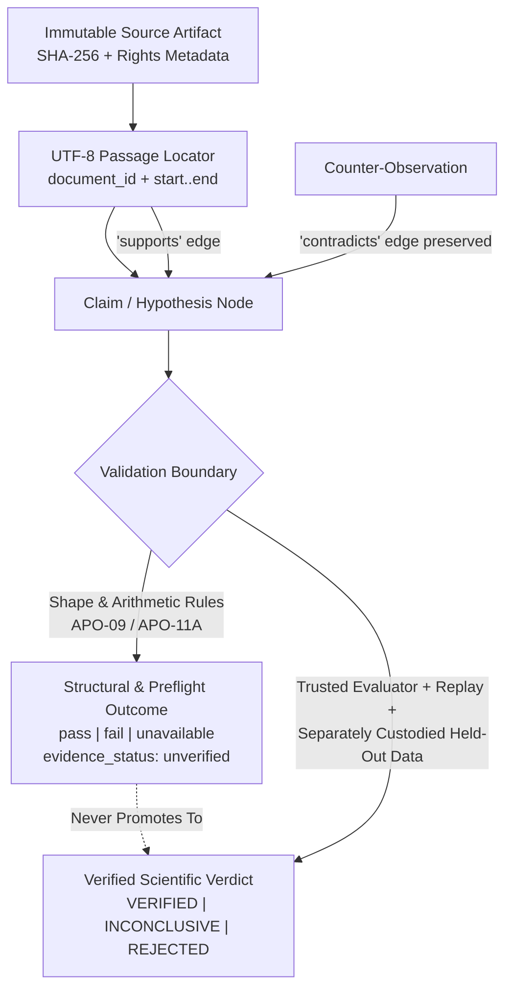

### Multi-Agent Development & Owner Approval Protocol

Development across AETHER uses isolated Git worktrees and file-based handoff logs under [`docs/agent-handoff/`](docs/agent-handoff/AGENT_SHARED.md) governed by [`HUMAN_APPROVAL_POLICY.md`](docs/governance/HUMAN_APPROVAL_POLICY.md). There is **no** automated live multi-agent orchestrator daemon in Rust.

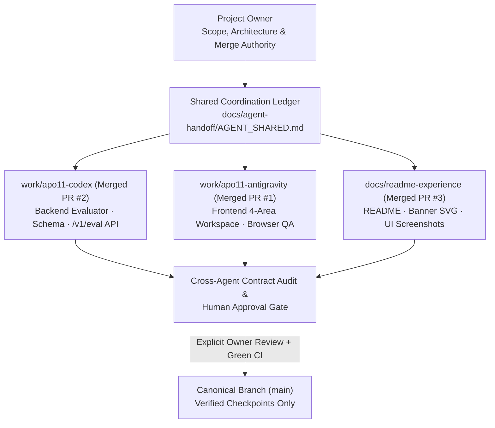

---

<a id="apo-11"></a>
## APO-11 Structural Evaluation

> [!NOTE]
> **Integration Status:** Both the APO-11 structural evaluation backend ([PR #2](https://github.com/akaKRISH/AETHER/pull/2) — [spec & limits](docs/research/APO11_STRUCTURAL_EVALUATION.md), [canonical schema](contracts/apo11/quality-evaluation.schema.json)) and the 4-area Research Quality Evaluation React workspace ([PR #1](https://github.com/akaKRISH/AETHER/pull/1)) are **merged on `main`**.

Instead of grading mutable database state, APO-11 enforces a two-step content-addressed evaluation flow:

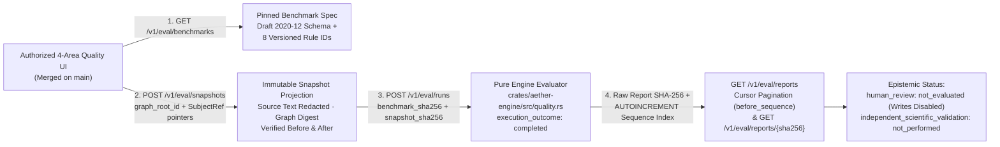

<details>
<summary><strong>APO-11 canonical dimensions, endpoint contracts, and admission ceilings</strong></summary>

1. `literature_scope_inventory_integrity` — Paper node presence inside a non-truncated graph projection (`truncated` maps to `unavailable`, empty inventory fails).
2. `claim_source_locator_integrity` — Claims link via `supports` / `contradicts` to evidence with valid, ordered UTF-8 byte locators.
3. `evidence_provenance_field_integrity` — Evidence origin, source-identity state, and epistemic status fields are structurally valid without authenticating identity.
4. `counterevidence_edge_integrity` — Contradiction polarity is preserved between distinct, existing graph endpoints (absent counterevidence maps cleanly to `unavailable`).
5. `hypothesis_structure_completeness` — Non-empty proposition, support/alternatives, assumptions, limitations, falsification condition, metrics, and resources.
6. `experiment_design_arithmetic_integrity` — Required controls, baselines, confounders, data separation, sample basis, stats plan, termination criteria, and checked budget sums.
7. `uncertainty_field_wellformedness` — Declared uncertainty grade within `0..=4` and explicit epistemic status (`unknown` stays distinct from missing).
8. `artifact_snapshot_replay_integrity` — Snapshot and graph digests verified with explicit truncation and source replay state (`unavailable` when rights-restricted text is omitted).

**Endpoints & Envelopes (`main` [`crates/aether-api/src/http.rs`](crates/aether-api/src/http.rs)):**
- `GET /v1/eval/benchmarks` · `GET /v1/eval/benchmarks/{sha256}`
- `POST /v1/eval/snapshots` (`201` created / `200` identical replay; `409 state_conflict` if graph mutates mid-capture)
- `POST /v1/eval/runs` (`201` created / `200` identical replay)
- `GET /v1/eval/reports?limit=N&before_sequence=S` (`limit` `1..=32`, survives SQLite `VACUUM`) · `GET /v1/eval/reports/{sha256}`
- Hard ceilings: `8 KiB` JSON request body (`413 request_too_large`), graph depth `3` (`64` nodes / `192` edges), `8` subject refs, `2 MiB` referenced artifact, `4 MiB` snapshot, `1 MiB` report. Note: Store blobs and Registry sequence index sit in separate SQLite databases and are not one atomic transaction.

</details>

---

## Screenshots

Captured directly from a local release build of `main` (`aether-lab serve` + built `web/dist`) using Playwright and non-sensitive development fixtures (`evidence-demo`, `DAE-04`, declarative skill registry, and APO-11 snapshot evaluation). **No public hosted demo exists; screenshots reflect the local loopback Research OS.**

<table width="100%">
  <tr>
    <td width="50%" valign="top">
      <a href="docs/assets/screenshots/aether-evidence-graph.png">
        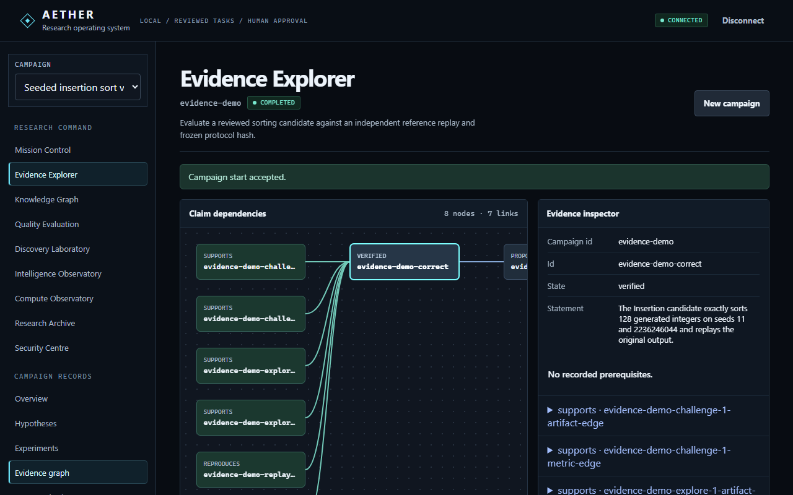
      </a>
      <br>
      <sub><strong>Evidence Explorer &amp; Claim Dependency Graph (Desktop):</strong> Interactive SVG claim DAG showing <code>SUPPORTS</code> / <code>REPRODUCES</code> links converging on a <code>VERIFIED</code> claim and inspector sidebar.</sub>
    </td>
    <td width="50%" valign="top">
      <a href="docs/assets/screenshots/aether-apo11-quality.png">
        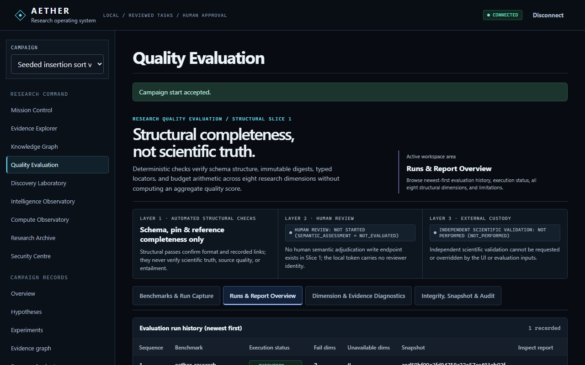
      </a>
      <br>
      <sub><strong>APO-11 Quality Evaluation Workspace (Desktop):</strong> Explicit 3-layer separation across automated structural checks, disabled human semantic review (<code>NOT_EVALUATED</code>), and external scientific validation (<code>NOT_PERFORMED</code>).</sub>
    </td>
  </tr>
  <tr>
    <td width="50%" valign="top">
      <a href="docs/assets/screenshots/aether-knowledge-discovery.png">
        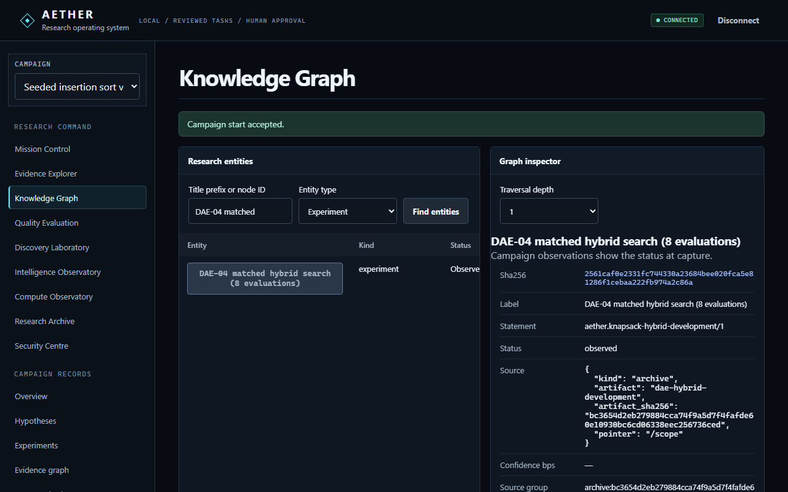
      </a>
      <br>
      <sub><strong>Knowledge Graph Explorer (Desktop):</strong> Pinned search over the <code>DAE-04 matched</code> slice inspecting exact SHA-256 node identity, statement schema, and archive pointer.</sub>
    </td>
    <td width="50%" valign="top">
      <a href="docs/assets/screenshots/aether-intelligence-observatory.png">
        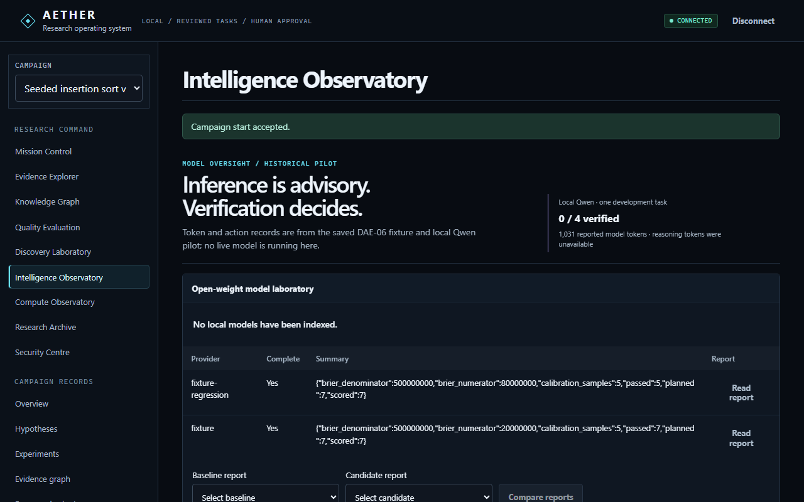
      </a>
      <br>
      <sub><strong>Intelligence Observatory (Desktop):</strong> Advisory inference framing (<em>"Inference is advisory. Verification decides."</em>) paired with local regression fixture comparisons.</sub>
    </td>
  </tr>
</table>

<p align="center">
  <a href="docs/assets/screenshots/aether-mission-mobile.png">
    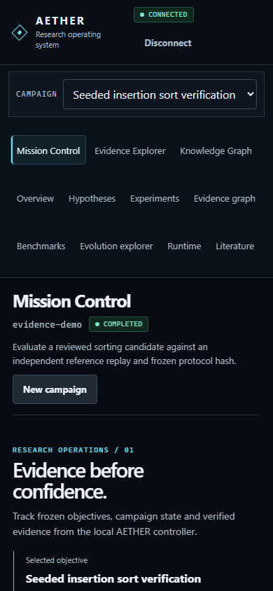
  </a>
  <br>
  <sub><strong>Mobile Command View (390×844):</strong> Responsive navigation and campaign header verified with zero horizontal overflow.</sub>
</p>

---

## Quick Start

AETHER runs strictly locally (`127.0.0.1`). No hosted SaaS backend or remote execution cluster is required.

### Prerequisites

- **Rust:** `1.96.1+` with `rustfmt` and `clippy` (Rust Edition 2024)
- **Node.js & npm:** Node `>=22.12.0` (CI runs Node `24`)
- **Python 3 *(optional)*:** Needed to run schema/link validators ([`scripts/validate_docs.py`](scripts/validate_docs.py), [`scripts/validate_apo11_contract.py`](scripts/validate_apo11_contract.py))

### Clone, Build & Verify

**Windows PowerShell:**

```powershell
git clone https://github.com/akaKRISH/AETHER.git
cd AETHER

cargo fmt --all -- --check
cargo clippy --locked --workspace --all-targets -- -D warnings
cargo test --locked --workspace --jobs 1
cargo build --locked --workspace --release

cd web
npm ci
npm run lint
npm run check
npm test
npm run build
cd ..
```

**Linux / macOS:**

```bash
git clone https://github.com/akaKRISH/AETHER.git
cd AETHER

cargo fmt --all -- --check
cargo clippy --locked --workspace --all-targets -- -D warnings
cargo test --locked --workspace --jobs 1
cargo build --locked --workspace --release

npm --prefix web ci
npm --prefix web run lint
npm --prefix web run check
npm --prefix web test
npm --prefix web run build
```

### Launch the Local Research OS & Verify Health

`aether-lab serve` requires a 32–128 byte secret token in `AETHER_TOKEN` and built assets in `web/dist` (see [`scripts/start-local.ps1`](scripts/start-local.ps1) and [`scripts/start-local.sh`](scripts/start-local.sh)):

```powershell
# PowerShell: generate ephemeral local token and start loopback server on 127.0.0.1:4040
$env:AETHER_TOKEN = [Convert]::ToHexString([Security.Cryptography.RandomNumberGenerator]::GetBytes(32))
cargo run --locked --bin aether-lab -- serve 4040
```

```bash
# Linux / macOS: generate ephemeral local token and start loopback server on 127.0.0.1:4040
export AETHER_TOKEN="$(openssl rand -hex 32)"
cargo run --locked --bin aether-lab -- serve 4040
```

Verify unauthenticated health in a second terminal, then open `http://127.0.0.1:4040` and paste your local `AETHER_TOKEN` in **Connect API**:

```bash
curl http://127.0.0.1:4040/health
# {"status":"ok","scope":"loopback"}
```

<details>
<summary><strong>CLI commands, protected HTTP /v1 routes, and documentation/contract validation</strong></summary>

- **Native M1 Fixture CLI (`aether`):**
  ```bash
  cargo run --locked -p aether-cli -- help
  ```
- **Research Platform CLI (`aether-lab`):**
  - Campaigns: `demo`, `plan`, `approve`, `run`, `report`, `list`, `recover`, `benchmark`, `evolve`, `discover`
  - Literature & Graph: `literature-discover`, `literature-ingest`, `literature-work`, `graph-paper`, `graph-report`, `graph-apply`, `graph-export`, `hypothesis-index`, `hypothesis-discover`, `design-experiments`, `design-validate`
  - Models & Data: `models-discover`, `models-inspect`, `models-evaluate`, `models-compare`, `training-fixture`, `training-rehearse`, `dataset-build`, `dataset-qualify`
  - Skills & Workflows: `skills-list`, `skill-approve`, `skill-execute`, `workflows-list`, `workflow-execute`, `workflow-benchmark`
- **Protected `/v1` Endpoints (Bearer auth + 8 KiB body limit):**
  `/v1/runtime`, `/v1/hardware`, `/v1/campaigns/*`, `/v1/artifacts/{sha256}`, `/v1/research/archive/*`, `/v1/models/*`, `/v1/training`, `/v1/datasets/*`, `/v1/skills/*`, `/v1/workflows/*`, `/v1/workflow-benchmarks/*`, `/v1/literature/*`, `/v1/knowledge/*`, `/v1/eval/{benchmarks,snapshots,runs,reports}`
- **Validators (with `requirements-validation.txt` installed):**
  ```bash
  python scripts/validate_docs.py
  python scripts/validate_apo11_contract.py
  ```

</details>

---

## Security

Security controls are grounded in [`THREAT_MODEL.md`](docs/security/THREAT_MODEL.md), [`PERMISSION_MODEL.md`](docs/security/PERMISSION_MODEL.md), and [`SECRETS_MANAGEMENT.md`](docs/security/SECRETS_MANAGEMENT.md).

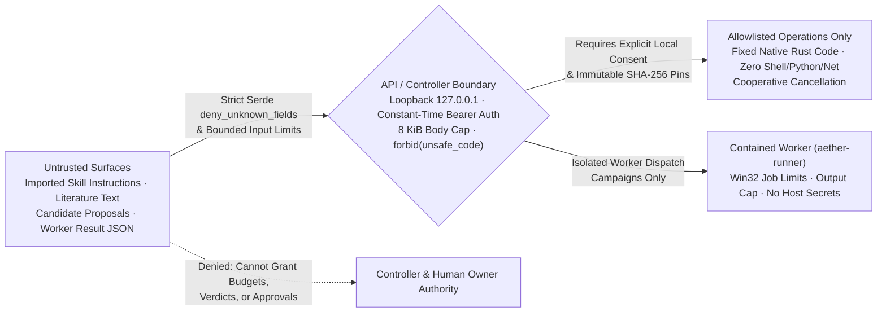

<details>
<summary><strong>Implemented boundaries, known limitations, and vulnerability disclosure</strong></summary>

- **Loopback & Auth:** Server binds strictly to `Ipv4Addr::LOCALHOST` (`127.0.0.1`); `/v1/*` routes validate bearer tokens in constant time; missing/wrong tokens fail uniformly with `401`.
- **Inert Skill Text:** Retrieved literature and imported skill instructions are stored and displayed purely as untrusted text — never interpreted or executed. No arbitrary shell, Python, plugin binary, or external network call capability is permitted inside skill execution.
- **Explicit Honest Limits:**
  - Local skill/workflow/protocol approval receipts identify `local_operator` and are consent records, **not** cryptographic signatures against an operator who holds direct filesystem/SQLite write access.
  - Synchronous native APO-09/APO-08 operations use cooperative cancellation between steps and do not claim hard preemption or an OS sandbox around synchronous Rust helpers.
  - No public security bounty or hosted incident contact exists yet; report concerns privately to the repository owner per [`SECURITY.md`](SECURITY.md) and [`INCIDENT_RESPONSE.md`](docs/security/INCIDENT_RESPONSE.md).

</details>

---

## Roadmap

Development progresses strictly by verified milestones and explicit owner decisions ([`EXECUTION_QUEUE.md`](EXECUTION_QUEUE.md), [`MASTER_ROADMAP.md`](docs/roadmap/MASTER_ROADMAP.md)):

| Horizon | Track / Item | Current State |
|---|---|---|
| **Completed on `main`** | Core crates (`aether-core`..`aether-api`), Prometheus/Athena, `APO-01`–`10`, `APO-11A` backend ([PR #2](https://github.com/akaKRISH/AETHER/pull/2)) & `APO-11B` frontend workspace ([PR #1](https://github.com/akaKRISH/AETHER/pull/1)) | Verified across Rust workspace CI (`ubuntu-latest` + `windows-latest`), frontend lint/typecheck/tests/build, schema/doc validators, and contract suites |
| **Deferred / Blocked** | Live adapter training (`APO-06C–F`), paired ECAR held-out study (`ATH-02B`) | Resource-blocked behind qualified hardware, independent test-set custody, and pre-registered review |
| **Proposed / Future** | Reviewer-identity write APIs, PDF full-text conversion & live provider qualification, R2/R3 SDK, OSS license & release gate | Requires separate threat review, license adoption, and explicit owner authorization |

---

## Documentation

| Group | Canonical Documents |
|---|---|
| **Project Overview** | [`PROJECT_CONTEXT.md`](PROJECT_CONTEXT.md) · [`PROJECT_STATUS.md`](PROJECT_STATUS.md) · [`RESUME.md`](RESUME.md) · [`EXECUTION_QUEUE.md`](EXECUTION_QUEUE.md) · [`CODEBASE_TOUR.md`](CODEBASE_TOUR.md) |
| **Architecture** | [`AETHER_MASTER_BLUEPRINT.md`](docs/AETHER_MASTER_BLUEPRINT.md) · [`SYSTEM_ARCHITECTURE.md`](docs/architecture/SYSTEM_ARCHITECTURE.md) · [`COMPONENT_ARCHITECTURE.md`](docs/architecture/COMPONENT_ARCHITECTURE.md) · [`STATE_MACHINES.md`](docs/architecture/STATE_MACHINES.md) |
| **Engineering Decisions** | [`ARCHITECTURE_DECISION_RECORDS.md`](docs/governance/ARCHITECTURE_DECISION_RECORDS.md) · [`ADR-014`](docs/decisions/ADR-014.md) – [`ADR-023`](docs/decisions/ADR-023.md) |
| **Research Integrity** | [`RESEARCH_INTEGRITY_POLICY.md`](docs/governance/RESEARCH_INTEGRITY_POLICY.md) · [`APOLLO_EXECUTION_PLAN.md`](docs/research/APOLLO_EXECUTION_PLAN.md) · [`APO11_STRUCTURAL_EVALUATION.md`](docs/research/APO11_STRUCTURAL_EVALUATION.md) · [`REPRODUCIBILITY_PROTOCOL.md`](docs/research/REPRODUCIBILITY_PROTOCOL.md) |
| **Security** | [`SECURITY.md`](SECURITY.md) · [`THREAT_MODEL.md`](docs/security/THREAT_MODEL.md) · [`PERMISSION_MODEL.md`](docs/security/PERMISSION_MODEL.md) · [`SECRETS_MANAGEMENT.md`](docs/security/SECRETS_MANAGEMENT.md) |
| **Testing & Reproducibility** | [`TEST_PLAN.md`](docs/testing/TEST_PLAN.md) · [`QUALITY_GATES.md`](docs/testing/QUALITY_GATES.md) · [`TEST_RESULTS.md`](docs/testing/TEST_RESULTS.md) · [`REQUIREMENTS_TRACEABILITY.md`](docs/testing/REQUIREMENTS_TRACEABILITY.md) |
| **Milestones & Roadmap** | [`MASTER_ROADMAP.md`](docs/roadmap/MASTER_ROADMAP.md) · [`RELEASE_CRITERIA.md`](docs/roadmap/RELEASE_CRITERIA.md) · [`NEXT_ACTIONS.md`](NEXT_ACTIONS.md) · [`CHANGELOG.md`](CHANGELOG.md) |
| **Agent Coordination** | [`AGENTS.md`](AGENTS.md) · [`AETHER_MULTI_AGENT_QUICKSTART.md`](AETHER_MULTI_AGENT_QUICKSTART.md) · [`AGENT_SHARED.md`](docs/agent-handoff/AGENT_SHARED.md) · [`docs/archive/`](docs/archive/README.md) |

---

<p align="center">
  
</p>

<p align="center">
  <strong>Contributing, Citation &amp; Licensing</strong><br>
  See <a href="CONTRIBUTING.md">CONTRIBUTING.md</a>, <a href="CODE_OF_CONDUCT.md">CODE_OF_CONDUCT.md</a>, and <a href="CITATION.cff">CITATION.cff</a>.<br>
  <strong>License Status:</strong> No open-source <code>LICENSE</code> file has been adopted yet (<em>Pending Owner Approval</em> — see <a href="LICENSE_DECISION.md">LICENSE_DECISION.md</a> and <a href="docs/governance/LICENSE_EVALUATION.md">LICENSE_EVALUATION.md</a>).
</p>
