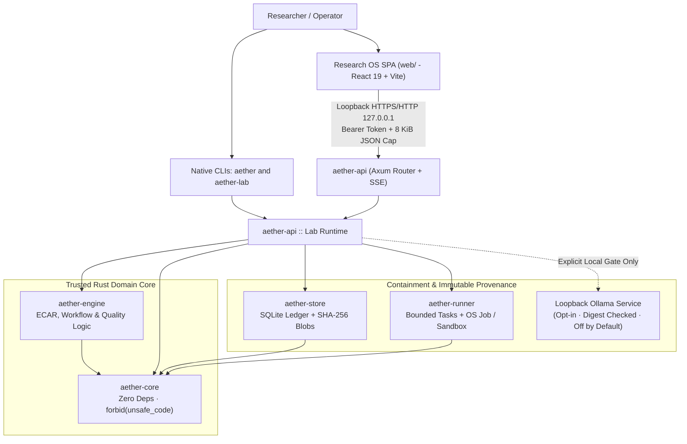
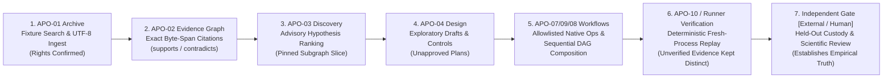
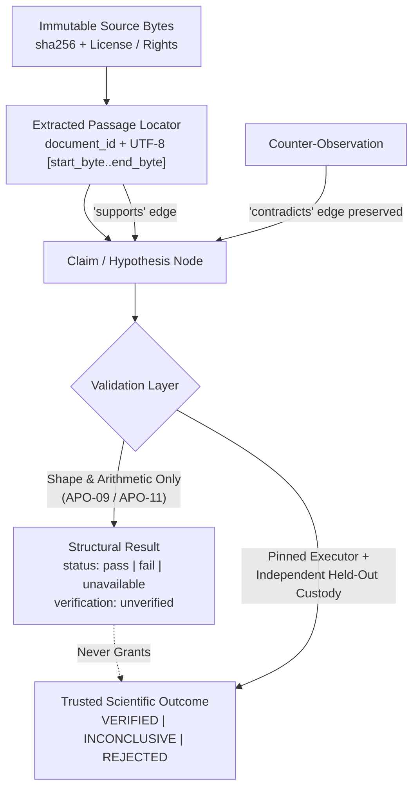
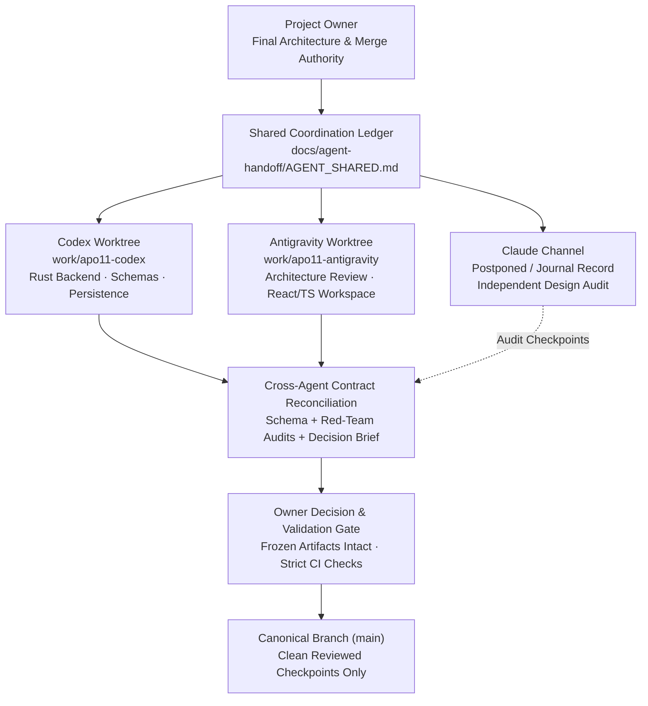
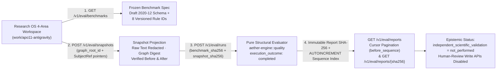

<p align="center">
  
</p>

<h1 align="center">AETHER</h1>

<p align="center">
  <strong>A Rust-first Personal Intelligence OS and scientific research engineering platform for evidence-grounded discovery, reproducible workflows, and independent evaluation.</strong>
</p>

<p align="center">
  <a href="https://github.com/akaKRISH/AETHER/actions/workflows/ci.yml"></a>
  
  
  
  
  
  
  <a href="LICENSE_DECISION.md"></a>
</p>

<p align="center">
  <a href="#1-executive-summary">Executive Summary</a> ·
  <a href="#3-current-status-vs-proposed-architecture">Status Matrix</a> ·
  <a href="#5-system-architecture-and-crate-map">Architecture</a> ·
  <a href="#9-apo-11-structural-evaluation-showcase">APO-11 Preview</a> ·
  <a href="#12-quick-start">Quick Start</a> ·
  <a href="#19-governance-decisions-and-documentation-hub">Documentation</a> ·
  <a href="#15-security-threat-model-and-privacy-boundaries">Security</a>
</p>

---

> [!IMPORTANT]
> **Engineering & Epistemic Boundary:** AETHER strictly separates **deterministic system mechanics** (reproducible state transitions, bounded execution, digest verification, and structural schema checks) from **scientific validity**. A passing test run, content-addressed receipt, or structural check does **not** establish hypothesis truth, literature relevance, causal validity, or research discovery. Scientific verification requires reviewed protocols, preserved negative results, and independent human/held-out custody.

---

## Table of Contents

- [1. Executive Summary](#1-executive-summary)
- [2. Why AETHER Exists](#2-why-aether-exists)
- [3. Current Status vs Proposed Architecture](#3-current-status-vs-proposed-architecture)
- [4. Core Capabilities and Feature Matrix](#4-core-capabilities-and-feature-matrix)
- [5. System Architecture and Crate Map](#5-system-architecture-and-crate-map)
- [6. End-to-End Scientific Research Lifecycle](#6-end-to-end-scientific-research-lifecycle)
- [7. Evidence, Provenance and Epistemic Verification](#7-evidence-provenance-and-epistemic-verification)
- [8. Multi-Agent Coordination Protocol](#8-multi-agent-coordination-protocol)
- [9. APO-11 Structural Evaluation Showcase](#9-apo-11-structural-evaluation-showcase)
- [10. Technology Stack and Dependency Pinning](#10-technology-stack-and-dependency-pinning)
- [11. Repository Layout](#11-repository-layout)
- [12. Quick Start](#12-quick-start)
- [13. CLI and API Reference Summary](#13-cli-and-api-reference-summary)
- [14. Testing, Validation and Reproducibility](#14-testing-validation-and-reproducibility)
- [15. Security, Threat Model and Privacy Boundaries](#15-security-threat-model-and-privacy-boundaries)
- [16. Historical Archives and Frozen Provenance](#16-historical-archives-and-frozen-provenance)
- [17. Milestone Evolution](#17-milestone-evolution)
- [18. Roadmap and Open Work](#18-roadmap-and-open-work)
- [19. Governance, Decisions and Documentation Hub](#19-governance-decisions-and-documentation-hub)
- [20. Contributing and Development Standards](#20-contributing-and-development-standards)
- [21. Citation](#21-citation)
- [22. Security Reporting](#22-security-reporting)
- [23. Acknowledgements and Design Lineage](#23-acknowledgements-and-design-lineage)
- [24. Licensing Status](#24-licensing-status)

---

## 1. Executive Summary

**AETHER** (*Autonomous Research and Engineering Laboratory*) is a local-first, Rust-owned **Personal Intelligence OS and scientific research platform** built around deterministic execution, content-addressed provenance, and explicit human authority gates.

Unlike autonomous-agent wrappers that equate fluent LLM output with scientific truth, AETHER constrains every operational layer with inspectable boundaries:

- **Deterministic Rust Core (`Rust Edition 2024`):** `aether-core` has zero external dependencies and `#![forbid(unsafe_code)]`, isolating domain state machines, budget arithmetic, and trusted scoring from I/O and model outputs.
- **Explicit Evidence Provenance:** Literature metadata, UTF-8 text spans (`start_byte..end_byte`), claims, contradictions, hypotheses, and experiment designs live in an immutable content-addressed artifact ledger backed by SQLite (`aether-store`).
- **Contained & Bounded Execution:** Native campaign runners, declarative research skills (`APO-07`), bounded synchronous skill execution (`APO-09`), and deterministic workflow DAGs (`APO-08` / `APO-10`) enforce checked budgets, digest pinning, and deny-by-default permissions.
- **Local Research OS Workspace:** An authenticated React 19 + TypeScript + Vite console (`web/`) communicates over a loopback-only Axum HTTP API (`127.0.0.1`) with constant-time bearer verification and strict payload bounds.

---

## 2. Why AETHER Exists

AI research assistants commonly fail in four structural ways: conflating syntax/formatting with empirical proof, erasing failed runs and contradictions, leaking authority/credentials to untrusted code or model prompts, and running irreproducible pipelines over shifting state.

AETHER is engineered around five invariant rules documented across [the master blueprint](docs/AETHER_MASTER_BLUEPRINT.md), [research integrity policy](docs/governance/RESEARCH_INTEGRITY_POLICY.md), and [threat model](docs/security/THREAT_MODEL.md):

1. **No Self-Grading:** Candidate generators or external workers never assign `VERIFIED` verdicts or overwrite trusted evaluation outputs.
2. **Preserve Failure & Contradiction:** Failed attempts, aborted campaigns, abstentions, and `contradicts` edges remain immutable first-class records.
3. **Separate Execution from Epistemic Validity:** A workflow or evaluation run can complete deterministically (`completed`) while scientific quality or evidence verification remains `unverified` or `not_performed`.
4. **Deny by Default:** Untrusted imported skill instructions are stored purely as inert quoted text; no arbitrary shell, Python, network, or plugin execution capability is granted to skill registries.
5. **Reproduce Before Scaling:** Every local capability progresses through frozen fixtures, SHA-256 replay checks, and explicit owner approval gates ([`HUMAN_APPROVAL_POLICY.md`](docs/governance/HUMAN_APPROVAL_POLICY.md)).

---

## 3. Current Status vs Proposed Architecture

This repository distinguishes strictly between **code verified on `main`**, **feature work completed on dedicated branch worktrees**, and **proposed/deferred design scope**.

| Capability / Component | Repository Status | Branch / Location | Verification Basis |
|---|---|---|---|
| **Native Fixture CLI (`aether`) & Core State Machine** | Implemented on `main` | `main` (`crates/aether-core`, `crates/aether-cli`) | M1 native fixture checks, replay and tamper tests |
| **SQLite + SHA-256 Artifact Ledger & Containment Runner** | Implemented on `main` | `main` (`crates/aether-store`, `crates/aether-runner`) | Store reopen/journal & Win32/Linux runner containment tests |
| **Prometheus / Athena Local Campaigns & ECAR Simulation** | Implemented on `main` | `main` (`crates/aether-engine`, `crates/aether-api`) | Deterministic synthetic simulation & controlled study fixtures |
| **APO-01/02 Literature Archive & Evidence Knowledge Graph** | Implemented on `main` | `main` (`crates/aether-api/src/literature`) | Fixture Crossref/OpenAlex/arXiv parsing, UTF-8 span grounding |
| **APO-03/04 Hypothesis Discovery & Experiment Design** | Implemented on `main` | `main` (`crates/aether-api/src/literature`) | DAE-04 20-case slice, 3 advisory experiment design drafts |
| **APO-05 Local Open-Weight Model Lab & Ollama Gate** | Implemented on `main` | `main` (`crates/aether-api/src/models`) | GGUF/SafeTensors digest checks, fixture & loopback Ollama eval |
| **APO-06A/B Training Proposals & Dataset Engineering** | Implemented on `main` | `main` (`crates/aether-api/src/models`) | Synthetic LoRA/QLoRA rehearsal, 26-row dev corpus manifest (`0c52ab...`) |
| **APO-07/09/08/10 Skills, Kernel, Workflows & Contract Eval** | Implemented on `main` | `main` (`crates/aether-api/src/models/{skills,workflows}.rs`) | 138 workspace tests (+9 ignored containment), 9 workflow + 7 adversarial fixtures |
| **Research OS Loopback Web Console (`web/`)** | Implemented on `main` | `main` (`web/`) | Vite production build, Biome, Node tests, desktop/mobile Playwright smoke |
| **APO-11A Structural Evaluation Backend** | **Feature branch** | [`work/apo11-codex`](https://github.com/akaKRISH/AETHER/tree/work/apo11-codex) | JSON Schema Draft 2020-12, 8 fixed rules, `/v1/eval/*` API, 119 Rust API+Engine tests |
| **APO-11B Quality Evaluation Frontend Workspace** | **Feature branch** | [`work/apo11-antigravity`](https://github.com/akaKRISH/AETHER/tree/work/apo11-antigravity) | 4-area Research Quality Workspace, 15 unit/smoke tests, Playwright specs |
| **Multi-Agent Coordination** | **File-based protocol** | `main` (`docs/agent-handoff/`) | Git worktrees + Markdown journals (`AGENT_SHARED.md`); **no** live daemon |
| **Live Adapter Training (`APO-06C–F`)** | **Deferred / Blocked** | Planned (`EXECUTION_QUEUE.md`) | Resource-blocked behind dataset rights, held-out custody & eval gates |
| **Human-Review Write APIs & Scientific Validation** | **Not Implemented** | Proposed (`APO11_STRUCTURAL_EVALUATION`) | Requires separate reviewer-identity policy; `independent_scientific_validation: not_performed` |
| **Cloud Hosting, Remote Multi-Tenant Auth & External SDK** | **Not Implemented** | Proposed (`MASTER_ROADMAP.md` R2/R3) | Out of current local loopback scope |

---

## 4. Core Capabilities and Feature Matrix

| Domain | What Works Today (`main` + Noted Feature Branches) | Hard Constraints & Guardrails |
|---|---|---|
| **Campaign & Protocol Kernel** | Freeze explicit JSON protocols (`aether-lab plan`), record local approval by exact SHA-256, run deterministic sorting/optimization benchmarks, recover interrupted campaigns (`recover`). | Protocol change invalidates approval; runner isolation skips network/credentials/host mounts. |
| **Literature & Knowledge Graph** | Cache bounded fixture pages (`crossref`/`openalex`/`arxiv`), ingest rights-confirmed UTF-8 full text, record span-pinned claims, project typed `supports`/`contradicts` subgraphs (`graph-export`). | Anonymous inspection denied; untrusted prompt-like text retained as quoted source bytes only. |
| **Hypothesis & Design Advisory** | Index 20 pinned DAE-04 matched cases (`hypothesis-index`), rank hypotheses (`hypothesis-discover`), inspect/validate 3 exploratory experiment designs (`design-experiments`). | Outputs carry `unverified` provenance; drafts lack statistical power calculations and remain unapproved. |
| **Model & Dataset Lab** | Discover local Ollama manifests, verify GGUF/SafeTensors SHA-256 (`models-inspect`), run deterministic dev dataset builds (`dataset-build`) with group-disjoint train/val splits (`18/8`). | `independent_test: external_custody_required`; lexical deduplication does not prove pretraining independence. |
| **Skills & Workflow Engine** | Register immutable versioned skills (`skills-list`), approve exact capability subsets locally, run fixed Rust operations via APO-09, compose acyclic typed DAGs sequentially (`APO-08`), evaluate 9+7 fixture cases (`APO-10`). | Fixed Rust allowlist only; zero shell/Python/network/arbitrary plugin execution; cooperative cancellation between synchronous steps. |
| **APO-11 Structural Evaluation *(Feature Branches)*** | Snapshot bounded graphs & typed artifacts (`POST /v1/eval/snapshots`), run 8 fixed structural dimensions (`POST /v1/eval/runs`), inspect paginated reports in 4 workspace views. | Structural shape/arithmetic check only (`pass` != true/novel/valid); `execution_outcome` stays independent of structural failures. |

---

## 5. System Architecture and Crate Map

AETHER enforces strict compile-time layering across six workspace crates (`resolver = "3"`, `edition = "2024"`, `publish = false`) plus the TypeScript/React SPA in `web/`:

| Component | Path | Responsibility | Internal Dependencies | Key Characteristics |
|---|---|---|---|---|
| **Core Kernel** | [`crates/aether-core`](crates/aether-core/README.md) | Protocol structs, IDs, budgets, state transitions, pure ranking & metrics | *None* | **Zero external crates**; `#![forbid(unsafe_code)]`; pure & deterministic |
| **Execution Engine** | [`crates/aether-engine`](crates/aether-engine/README.md) | ECAR policy simulation, scheduling traces, recovery & structural evaluators *(branch)* | `aether-core` | Pure domain orchestration + deterministic study reports |
| **Provenance Store** | [`crates/aether-store`](crates/aether-store/README.md) | SQLite schema migrations (`001_initial.sql`), SHA-256 artifact blobs, transactional events | `aether-core`, `aether-engine` | `rusqlite` bundled SQLite, digest verification on read |
| **Worker Runner** | [`crates/aether-runner`](crates/aether-runner/README.md) | Reviewed task harnesses, output caps (`MAX_OUTPUT`), OS containment & supervision | `aether-core`, `aether-engine` | Windows Job Objects (`win32job`), Linux containment checks |
| **Native CLI** | [`crates/aether-cli`](crates/aether-cli/README.md) | M1 native fixture CLI (`aether`) | `aether-core`, `aether-engine`, `aether-store`, `aether-runner` | Standalone native fixture verification without HTTP/JS |
| **API & Lab Server** | [`crates/aether-api`](crates/aether-api/README.md) | Full `aether-lab` CLI & loopback Axum HTTP/SSE server hosting `web/dist` | `aether-core`, `aether-engine`, `aether-store`, `aether-runner` | `#![forbid(unsafe_code)]`; `127.0.0.1` bind; 8 KiB body cap; bearer middleware |
| **Research OS UI** | `web/` | Single-page Research OS workspace (campaigns, knowledge, skills, observatory, datasets) | Loopback `/v1` JSON & SSE API | React 19.3.1, TypeScript 5.9.3, Vite 7.3.8, Biome 2.6.9, Playwright 1.65.1 |

### Overall System Architecture



---

## 6. End-to-End Scientific Research Lifecycle

From source acquisition to independent evaluation, AETHER enforces hash-pinned transitions at every stage:



Every arrow preserves immutable artifact digests. No downstream artifact (such as a ranked hypothesis or workflow receipt) silently upgrades upstream source or claim verification status.

---

## 7. Evidence, Provenance and Epistemic Verification

AETHER refuses to treat structural metadata or model fluency as verification:



- **Key distinction:** In APO-10 and APO-11 reports, **evidence remains `unverified`** unless a separate trusted verification protocol evaluates independent data. Preserved failures (` ResearchLedger`) ensure researchers see dead ends alongside positive candidates.

---

## 8. Multi-Agent Coordination Protocol

> [!NOTE]
> **Documentation-Governed Process:** Multi-agent development across AETHER uses **isolated Git worktrees and append-only Markdown handoff logs** under [`docs/agent-handoff/`](docs/agent-handoff/AGENT_SHARED.md). There is **no** automated live multi-agent coordinator runtime inside the Rust workspace on `main`.



---

## 9. APO-11 Structural Evaluation Showcase

> [!NOTE]
> **Feature Branch Preview (Not Merged to `main`):** The **APO-11 Research Quality Evaluation** slice is implemented and locally validated across two dedicated feature branches — [`work/apo11-codex`](https://github.com/akaKRISH/AETHER/tree/work/apo11-codex) (backend) and [`work/apo11-antigravity`](https://github.com/akaKRISH/AETHER/tree/work/apo11-antigravity) (frontend) — ahead of owner merge integration.

### Two-Step Immutable Evaluation Flow

Instead of scoring mutable live database state, APO-11 binds every evaluation run to a content-addressed, text-redacted **snapshot**:



### Eight Fixed Structural Dimensions

Every persisted APO-11 report evaluates all eight canonical dimensions (`pass` | `fail` | `unavailable`), separating dimension failures from completed execution:

1. `literature_scope_inventory_integrity` — Paper node presence in a non-truncated graph slice.
2. `claim_source_locator_integrity` — Typed `supports` / `contradicts` claim links referencing structurally valid byte locators.
3. `evidence_provenance_field_integrity` — Structural provenance origins, explicit source-identity fields, and epistemic-status presence.
4. `counterevidence_edge_integrity` — Directed contradiction polarity and distinct non-self graph endpoints.
5. `hypothesis_structure_completeness` — Non-empty proposition, support/alternatives, assumptions, limitations, falsification condition, metrics, and resources.
6. `experiment_design_arithmetic_integrity` — Required controls, baselines, confounders, data separation, sample basis, stats plan, termination criteria, and checked budget sums.
7. `uncertainty_field_wellformedness` — Declared uncertainty grade (`0..=4`) and explicit epistemic status (`unknown` kept distinct from missing).
8. `artifact_snapshot_replay_integrity` — Verified snapshot/graph digests with explicit truncation and source replay state (`unavailable` when rights-restricted text is redacted).

### Four-Area Frontend Architecture (`work/apo11-antigravity`)

Following contract red-teaming ([decision brief on feature branch](https://github.com/akaKRISH/AETHER/tree/work/apo11-antigravity)), an initial 11-screen draft was consolidated into **4 focused operational areas**:

1. **Benchmark & Dimensions** — Embedded Draft 2020-12 schema pins, structural scope, ceiling constants, and versioned rules.
2. **Snapshot & Execute** — Bounded graph/artifact selection (`POST /v1/eval/snapshots`) -> immutable receipt -> run dispatch (`POST /v1/eval/runs`).
3. **Reports & Detail Drawer** — Stable cursor-paginated report table (`before_sequence`) with slide-over dimension rollups, check reason codes, and raw digest copy/inspection.
4. **Structural Semantics & Limits** — Explicit epistemic warnings, `not_performed` scientific validation notices, and ceiling enforcement reference.

---

## 10. Technology Stack and Dependency Pinning

All versions below match [`Cargo.toml`](Cargo.toml), workspace crate manifests, [`web/package.json`](web/package.json), and [`.github/workflows/ci.yml`](.github/workflows/ci.yml):

| Layer | Technology / Crate | Version / Spec | Purpose |
|---|---|---|---|
| **Systems Language** | Rust | **Edition 2024** (CI toolchain `1.96.1`) | Deterministic domain logic, CLI, containment, persistence & API |
| **Async & HTTP** | `tokio`, `axum`, `futures-util` | `1`, `0.8`, `0.3` | Loopback async runtime, `/v1` router, middleware & SSE streaming |
| **Persistence & Digest** | `rusqlite`, `sha2` | `0.43` (`bundled`), `0.10` | SQLite ledger, migrations & SHA-256 content addressing |
| **Serialization & XML** | `serde`, `serde_json`, `roxmltree`, `thiserror` | `1` (`derive`), `1`, `0.21`, `2` | Strict `deny_unknown_fields` contracts & arXiv Atom XML parsing |
| **HTTP Client / Bench** | `ureq`, `criterion` | `3.5`, `0.8.2` *(dev)* | Bounded fixture/provider adapter & microbenchmarks |
| **Windows Isolation** | `win32job`, `windows` | `=2.0.3`, `=0.61.3` *(target)* | Windows Job Object limits & process-tree supervision |
| **Frontend Stack** | React, React DOM, TypeScript | `^19.3.1`, `~5.9.3` | Strict typed Research OS single-page interface |
| **Build, Lint & Browser QA** | Vite, Biome, Playwright, Node.js | `~7.3.8`, `2.6.9`, `1.65.1`, `>=22.12.0` (CI `24`) | Bundling, formatting/linting & automated desktop/mobile smoke tests |

---

## 11. Repository Layout

```text
AETHER/
├── .github/workflows/ci.yml      # GitHub Actions: Rust (Windows + Ubuntu) & Web CI
├── Cargo.toml / Cargo.lock       # Rust Edition 2024 workspace (6 crates, resolver 3)
├── crates/
│   ├── aether-core/              # Pure domain state, protocol, budgets, ranking (0 deps)
│   ├── aether-engine/            # Study simulation, ECAR scheduling, workflow logic
│   ├── aether-store/             # SQLite store (001_initial.sql) & content-addressed blobs
│   ├── aether-runner/            # Task evaluator & OS containment supervision
│   ├── aether-cli/               # Native fixture CLI (`aether`)
│   └── aether-api/               # `aether-lab` CLI, literature/models/skills/workflows & HTTP API
├── web/                          # React 19 + TypeScript Research OS frontend (`aether-console`)
├── contracts/ & benchmarks/      # Canonical schemas & benchmark fixtures
├── research/                     # Curated study literature & immutable `research/results/`
├── docs/
│   ├── assets/                   # Project visual assets (README banner SVG)
│   ├── archive/                  # Frozen Genesis, v0.1 & v0.2 archives + SHA256SUMS
│   ├── architecture/             # System, component, database, failure & worker specs
│   ├── decisions/                # ADR-001 through ADR-023 architectural records
│   ├── diagrams/                 # 21 Mermaid sources + rendered SVGs
│   ├── engineering/              # Coding standards, Prometheus audit & concurrency model
│   ├── governance/               # Human approval, research integrity & license evaluation
│   ├── security/                 # Threat model, sandbox, secrets & incident response
│   ├── testing/                  # Test plan, quality gates, results & traceability
│   └── agent-handoff/            # Shared ledger & individual agent coordination journals
├── scripts/                      # Startup scripts, doc validator & helper fixtures
└── tests/                        # End-to-end Playwright browser smoke suite
```

---

## 12. Quick Start

### Prerequisites

- **Rust toolchain:** Rust **1.96.1+** (Edition 2024 support)
- **Node.js:** **22.12.0+** (CI runs **24**) & npm
- **Python 3:** Recommended for [`scripts/validate_docs.py`](scripts/validate_docs.py) (`requirements-validation.txt`)

### 1. Build and Verify the Workspace (`main`)

```powershell
# PowerShell (Windows) / equivalent Unix shells
cargo fmt --all -- --check
cargo clippy --locked --workspace --all-targets -- -D warnings
cargo test --locked --workspace --jobs 1
cargo build --locked --workspace --release --jobs 1
```

Build and verify the frontend workspace inside `web/`:

```powershell
cd web
npm ci
npm run lint
npm run check
npm test
npm run build
cd ..
```

Validate all schemas, JSON payloads, Mermaid pairings, archive fingerprints, and relative links:

```powershell
python scripts/validate_docs.py
```

### 2. Run the Native M1 Fixture CLI

```powershell
cargo run --locked -p aether-cli -- help
```

### 3. Launch the Local Research OS Server (`aether-lab serve`)

`aether-lab` binds strictly to `127.0.0.1` and requires a random bearer token (`32–128` bytes) in `AETHER_TOKEN` plus built frontend assets in `web/dist` (see [`scripts/start-local.ps1`](scripts/start-local.ps1) and [`scripts/start-local.sh`](scripts/start-local.sh)):

```powershell
# PowerShell
$env:AETHER_TOKEN = [Convert]::ToHexString([Security.Cryptography.RandomNumberGenerator]::GetBytes(32))
npm --prefix web run build
cargo run --locked --bin aether-lab -- serve 4040
```

```bash
# Linux / macOS
export AETHER_TOKEN="$(openssl rand -hex 32)"
npm --prefix web run build
cargo run --locked --bin aether-lab -- serve 4040
```

Then verify loopback health (unauthenticated) before signing into `http://127.0.0.1:4040` with your local `AETHER_TOKEN`:

```bash
curl http://127.0.0.1:4040/health
# {"status":"ok","scope":"loopback"}
```

---

## 13. CLI and API Reference Summary

### Core `aether-lab` Subcommand Groups ([`crates/aether-api/src/main.rs`](crates/aether-api/src/main.rs))

| Group | Example Subcommands | Purpose |
|---|---|---|
| **Campaigns & Studies** | `demo`, `plan`, `approve`, `run`, `report`, `list`, `recover`, `benchmark`, `evolve`, `discover` | Freeze protocol JSON, bind SHA-256 approval, run simulations/campaigns |
| **Literature & Graph** | `literature-discover`, `literature-ingest`, `literature-work`, `graph-paper`, `graph-report`, `graph-export` | Bounded fixture discovery, UTF-8 text ingest & subgraph export |
| **Hypothesis & Design** | `hypothesis-index`, `hypothesis-discover`, `design-experiments`, `design-validate` | DAE-04 slice indexing, advisory ranking & unapproved draft checks |
| **Models, Training & Data** | `models-discover`, `models-inspect`, `models-evaluate`, `training-rehearse`, `dataset-build`, `dataset-qualify` | Local model hashing, synthetic LoRA/QLoRA checks & dev dataset splits |
| **Skills & Workflows** | `skills-list`, `skill-approve`, `skill-execute`, `workflows-list`, `workflow-execute`, `workflow-benchmark` | Declarative registry, bounded APO-09 execution & APO-10 contract eval |
| **Server** | `serve [port]` | Authenticated loopback HTTP + SSE API hosting built SPA assets |

### Authenticated Loopback HTTP Surface ([`crates/aether-api/src/http.rs`](crates/aether-api/src/http.rs))

- **Public Routes:** `GET /`, `GET /health`, `GET /assets/{name}`
- **Protected `/v1` Routes (Bearer Token + 8 KiB Body Cap):**
  - `/v1/runtime`, `/v1/hardware`
  - `/v1/campaigns`, `/v1/campaigns/{id}`, `/v1/campaigns/{id}/{runs,claims,approve,start,cancel,events,stream,report,protocol}`
  - `/v1/artifacts/{sha256}`, `/v1/research/archive`, `/v1/research/archive/{id}`
  - `/v1/models`, `/v1/models/compare/{baseline}/{candidate}`, `/v1/training`, `/v1/datasets`, `/v1/datasets/qualify`
  - `/v1/skills`, `/v1/skills/{sha256}`, `/v1/skills/{invocations,execute,executions,compose}`
  - `/v1/workflows`, `/v1/workflows/{sha256}`, `/v1/workflows/{execute,executions}`, `/v1/workflow-benchmarks`, `/v1/workflow-benchmarks/run`
  - `/v1/literature`, `/v1/literature/work`, `/v1/knowledge`, `/v1/knowledge/{id}`, `/v1/knowledge/{id}/{hypotheses,designs}`
  - *(Feature branch `work/apo11-codex`)* `/v1/eval/benchmarks`, `/v1/eval/benchmarks/{sha256}`, `/v1/eval/snapshots`, `/v1/eval/runs`, `/v1/eval/reports`, `/v1/eval/reports/{sha256}`

---

## 14. Testing, Validation and Reproducibility

Validation results recorded in [`docs/testing/TEST_RESULTS.md`](docs/testing/TEST_RESULTS.md) and [`RESUME.md`](RESUME.md):

| Scope | Reported Result | Key Conditions & Caveats |
|---|---|---|
| **`main` (APO-10 Baseline)** | `138` workspace tests passed (`9` existing runner containment tests ignored by default; invoked containment harness checks also ran); API package `67` unit + `21` platform tests | Clippy (`-D warnings`), `cargo fmt --check`, release build, Biome/tsc/5 frontend tests/build, Playwright smoke & `validate_docs.py` (`13` schemas, `68` JSON, `282` Markdown, `21` SVG, `102` source fingerprints) passed. |
| **APO-10 Fresh-Process Replay** | `9/9` controlled workflows & `7/7` adversarial checks passed; report [`apo-10-workflow-contract-evaluation.json`](research/results/apo-10-workflow-contract-evaluation.json) SHA-256 `398accf...` | Deterministic contract behavior only; scientific-quality metrics explicitly `null`. |
| **`work/apo11-codex` *(Feature Branch)*** | `119` Rust tests passed (`71` API unit, `22` platform, `26` engine), `0` failed, `0` ignored | Plus contract validator (`benchmark` + `8` fixtures), Clippy, fmt, release build & doc validator (`14` schemas, `78` JSON, `296` Markdown). |
| **`work/apo11-antigravity` *(Feature Branch)*** | Frontend `lint`, `tsc`, Vite `build`, `15` Node unit/workspace tests & browser smoke specs executed locally on branch | Requires the `work/apo11-codex` backend `/v1/eval/*` binary for full live API integration. |

---

## 15. Security, Threat Model and Privacy Boundaries

Security architecture is governed by [`THREAT_MODEL.md`](docs/security/THREAT_MODEL.md), [`SECRETS_MANAGEMENT.md`](docs/security/SECRETS_MANAGEMENT.md), and [`AI_AGENT_SAFETY.md`](docs/security/AI_AGENT_SAFETY.md):

- **Loopback Isolation:** HTTP binds strictly to `Ipv4Addr::LOCALHOST` (`127.0.0.1`).
- **Constant-Time Auth:** Bearer comparison uses full-length constant-time byte XOR folding; malformed or missing tokens return uniform HTTP `401`.
- **Bounded Intake:** Axum `DefaultBodyLimit::max(8192)` rejects oversized requests (`413` envelope on APO-11 routes).
- **No `unsafe` Core/API:** Both `aether-core` and `aether-api` declare `#![forbid(unsafe_code)]`.
- **Inert Text Discipline:** Retrieved literature passages and imported skill instructions are sanitized/treated strictly as untrusted quoted data — never interpreted as commands.
- **No Committed Secrets:** Runtime tokens, SQLite databases (`.aether/`), local private assistant files, and environment files (`.env*`) are excluded by [`.gitignore`](.gitignore) and secret hygiene audits.

---

## 16. Historical Archives and Frozen Provenance

Two directory subtrees remain **byte-frozen** against accidental alteration:

- [`docs/archive/`](docs/archive/README.md): Preserves the original pre-implementation Genesis specifications, `v0.1` Python-first archive, `v0.2` Rust-first engineering book, and early handoffs (`102` source files verified against `docs/archive/SHA256SUMS`).
- `research/results/`: Retains immutable benchmark and contract evaluation JSON records (`research/results/apo-10-workflow-contract-evaluation.json` and prior baseline artifacts), ensuring historical failures and baseline measurements are never retroactively edited.

---

## 17. Milestone Evolution

Detailed per-milestone logs live in [`PROJECT_STATUS.md`](PROJECT_STATUS.md) and [`RESUME.md`](RESUME.md):

- **Phase 0 / M1 Foundation:** Genesis archive verification, doc/schema validators, 6-crate layout, native deterministic fixture CLI (`aether`).
- **Operation Prometheus & Athena:** Contained runner hardening, ECAR scheduling pilot, SQLite provenance store, local hardware inspection, and qualified loopback inference gate.
- **APO-01 -> APO-04:** Literature fixture discovery & UTF-8 archival, transactional knowledge graph, hypothesis discovery on DAE-04, and exploratory experiment design validation.
- **APO-05 -> APO-06A/B:** Local GGUF/SafeTensors model registry, synthetic training feasibility rehearsals, and group-disjoint development dataset engineering.
- **APO-07 -> APO-09 -> APO-08 -> APO-10:** Versioned declarative skill registry, bounded synchronous execution kernel, sequential workflow orchestrator, and 2-process contract evaluation.
- **APO-11 *(Active Feature Branches)*:** Fixed 8-dimension structural quality evaluator (`work/apo11-codex`) and 4-area Research Quality Evaluation workspace (`work/apo11-antigravity`).

---

## 18. Roadmap and Open Work

Track the full backlog in [`EXECUTION_QUEUE.md`](EXECUTION_QUEUE.md) and [`MASTER_ROADMAP.md`](docs/roadmap/MASTER_ROADMAP.md):

1. **Integrate & Verify APO-11:** Complete owner review and cross-branch integration testing of `work/apo11-codex` + `work/apo11-antigravity` before any merge into `main`.
2. **Reviewer Identity Policy:** Define explicit human reviewer identity, audit trails, and independent scientific validation workflows before enabling any review write endpoints.
3. **APOLLO Corpus Expansion:** Extend rights-reviewed full-text formats (including carefully mapped PDF conversion and live provider qualification).
4. **Gate `APO-06C–F` Adaptation:** Keep live adapter training deferred behind hardware qualification, external test-set custody, and pre-registered evaluation criteria.
5. **Release & Licensing Readiness:** Complete authorship, dependency-notice, and license approval prior to public versioned releases or SDK exposure.

---

## 19. Governance, Decisions and Documentation Hub

| Category | Key Documents |
|---|---|
| **Project State & Tour** | [`PROJECT_CONTEXT.md`](PROJECT_CONTEXT.md) · [`PROJECT_STATUS.md`](PROJECT_STATUS.md) · [`RESUME.md`](RESUME.md) · [`EXECUTION_QUEUE.md`](EXECUTION_QUEUE.md) · [`CODEBASE_TOUR.md`](CODEBASE_TOUR.md) |
| **Architecture** | [`AETHER_MASTER_BLUEPRINT.md`](docs/AETHER_MASTER_BLUEPRINT.md) · [`SYSTEM_ARCHITECTURE.md`](docs/architecture/SYSTEM_ARCHITECTURE.md) · [`COMPONENT_ARCHITECTURE.md`](docs/architecture/COMPONENT_ARCHITECTURE.md) · [`STATE_MACHINES.md`](docs/architecture/STATE_MACHINES.md) |
| **Decisions (ADRs)** | [`ARCHITECTURE_DECISION_RECORDS.md`](docs/governance/ARCHITECTURE_DECISION_RECORDS.md) · [`ADR-014`](docs/decisions/ADR-014.md) (Literature) · [`ADR-015`](docs/decisions/ADR-015.md) (Graph) · [`ADR-021`](docs/decisions/ADR-021.md) (Skills) · [`ADR-022`](docs/decisions/ADR-022.md) (Kernel) · [`ADR-023`](docs/decisions/ADR-023.md) (Workflows) |
| **Governance & Safety** | [`HUMAN_APPROVAL_POLICY.md`](docs/governance/HUMAN_APPROVAL_POLICY.md) · [`RESEARCH_INTEGRITY_POLICY.md`](docs/governance/RESEARCH_INTEGRITY_POLICY.md) · [`THREAT_MODEL.md`](docs/security/THREAT_MODEL.md) · [`SECRETS_MANAGEMENT.md`](docs/security/SECRETS_MANAGEMENT.md) |
| **Testing & Research** | [`TEST_PLAN.md`](docs/testing/TEST_PLAN.md) · [`QUALITY_GATES.md`](docs/testing/QUALITY_GATES.md) · [`TEST_RESULTS.md`](docs/testing/TEST_RESULTS.md) · [`REQUIREMENTS_TRACEABILITY.md`](docs/testing/REQUIREMENTS_TRACEABILITY.md) · [`APOLLO_EXECUTION_PLAN.md`](docs/research/APOLLO_EXECUTION_PLAN.md) |
| **Agent Coordination** | [`AGENTS.md`](AGENTS.md) · [`AETHER_MULTI_AGENT_QUICKSTART.md`](AETHER_MULTI_AGENT_QUICKSTART.md) · [`AGENT_SHARED.md`](docs/agent-handoff/AGENT_SHARED.md) |

---

## 20. Contributing and Development Standards

See [`CONTRIBUTING.md`](CONTRIBUTING.md), [`CODE_OF_CONDUCT.md`](CODE_OF_CONDUCT.md), and [`CODING_STANDARDS.md`](docs/engineering/CODING_STANDARDS.md).

- Work in small, reviewable slices traced to explicit requirement and test IDs.
- Keep `docs/archive/` and prior frozen records in `research/results/` byte-identical.
- Never self-certify heuristics or bypass owner approval gates for destructive, paid, public, or execution-broadening changes.
- Ensure `cargo fmt --all -- --check`, `cargo clippy --locked --workspace --all-targets -- -D warnings`, workspace tests, `web/` checks, and `scripts/validate_docs.py` pass locally.

---

## 21. Citation

Metadata from [`CITATION.cff`](CITATION.cff):

```bibtex
@software{aether_project,
  title  = {AETHER -- Autonomous Research and Engineering Laboratory},
  author = {{AETHER Project}},
  url    = {https://github.com/akaKRISH/AETHER},
  note   = {Local-first Rust Edition 2024 research engineering platform and Research OS}
}
```

---

## 22. Security Reporting

Do **not** open public issues with exploit payloads, real tokens, private credentials, or hidden evaluation data. Please inspect [`SECURITY.md`](SECURITY.md) and [`INCIDENT_RESPONSE.md`](docs/security/INCIDENT_RESPONSE.md) and report security concerns privately to the repository owner via the direct project coordination channel until a dedicated public advisory policy is approved.

---

## 23. Acknowledgements and Design Lineage

AETHER builds upon the pre-implementation Genesis specifications (`v0.1` Python-first archive and `v0.2` Rust-first engineering volume), empirical discipline from reproducible systems engineering, and open ecosystems including Rust Edition 2024, Axum, Tokio, SQLite (`rusqlite`), React, TypeScript, Vite, Biome, and Playwright.

---

## 24. Licensing Status

**Status:** **No open-source `LICENSE` file has been adopted yet (`Pending Owner Approval`).**

As documented in [`LICENSE_DECISION.md`](LICENSE_DECISION.md) and [`LICENSE_EVALUATION.md`](docs/governance/LICENSE_EVALUATION.md), historical `v0.2` design chapters discussed `Apache-2.0` for first-party material, but formal copyright/authorship review, third-party dependency/dataset/model notices, and release approval remain pending. Do not assume redistribution rights beyond explicit owner authorization until an approved `LICENSE` file is committed at the release gate.
