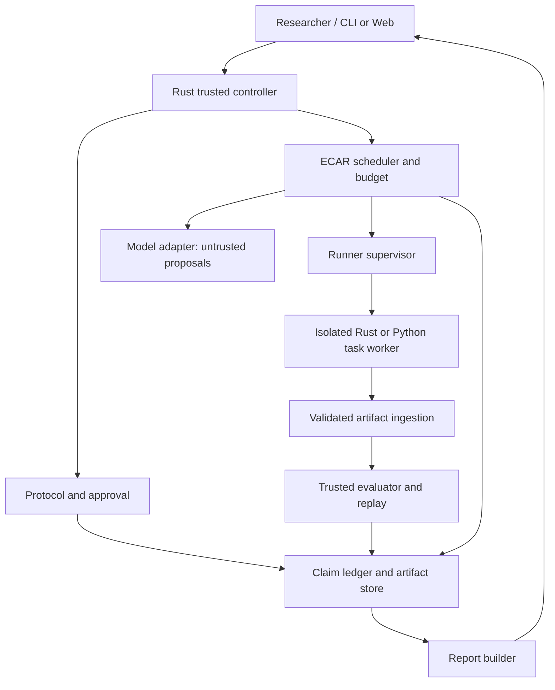

# 05 | System architecture (HLD)

## Architectural choice
A native Rust modular monolith with a separate trusted runner supervisor and untrusted sandbox. One controller process owns domain transitions and transactional persistence. A web service is a thin adapter over the same application service later. Avoid microservices, Kubernetes, multi-agent frameworks, distributed queues and graph databases until the local scientific loop is correct. Trust boundaries matter more than process count.

## Interfaces and responsibilities
Controller: validates inputs, commits state, creates jobs and exports reports. Protocol service: freezes task, evaluation tolerances, datasets, budgets, approved tool policy. Scheduler: consumes graph state and budget, emits typed actions; no direct execution. Model adapter: receives redacted context and returns a schema-validated proposal, never shell access. Supervisor: creates restricted sandbox, applies timeout and quotas, validates artifact paths. Evaluator: loads prediction artifacts, computes metrics on hidden labels outside candidate sandbox, replays selected candidate code in clean environment. Ledger: records provenance and claim status in trusted database; artifacts content-addressed by SHA-256.

## Deployment topology
R0/R1: Windows + WSL2 Linux development if supported, or native Linux; host CLI/controller and SQLite, local artifact directory, rootless isolated runtime. Sandbox is treated as defense-in-depth, not a perfect security boundary; do not execute arbitrary third-party code on a personal machine. R2: API/UI and PostgreSQL only when concurrent clients need them; remote workers receive minimal signed/authorized jobs via explicit configuration. Runner never receives provider keys. External literature/model calls originate only in approved controller adapters.

## Data and control flows
User approves protocol -> controller reserves budget transactionally -> scheduler emits action -> supervisor leases run -> sandbox executes approved task -> supervisor captures outputs -> evaluator validates artifacts and hidden metrics -> controller commits verdict and usage -> scheduler selects next action or stops -> report reads ledger. On failure, lease expires, outputs quarantined, reservation settled and failure recorded. Refer to `diagrams/` for editable source.

## Language and process boundaries
Rust owns every authoritative transition. A reviewed Python worker receives an immutable job manifest and read-only task inputs, and emits bounded prediction artifacts and a result envelope. A trusted Rust evaluator scores outputs on separate held-out labels. A specialized reviewed Python verifier may be added for unsupported metrics in a separate trusted process, never in candidate context. No embedded Python or direct database access from candidate workers. CLI and later Axum service share the same Rust application interfaces. See 21_RUST_ENGINEERING.md.
