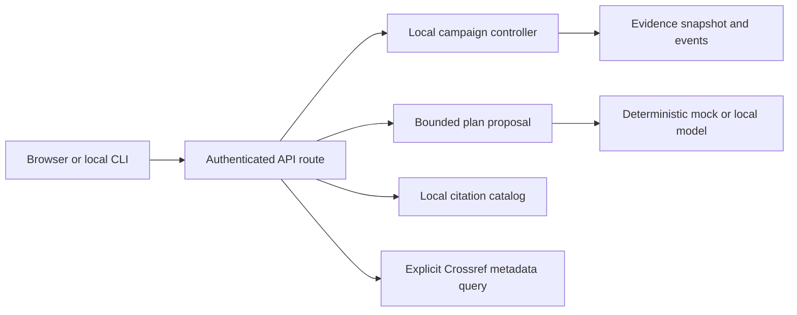

# HTTP, asynchronous programming, agents and literature

An API lets a browser request a read or state change with typed data. A language model produces probable next tokens, which can be assembled into a structured proposal. An agent adds a loop that uses observations and chooses an approved next action. AETHER keeps action authority in the controller and only uses proposed sort algorithm choices as draft data.

## Follow a request from browser to Rust

1. In [`App`](../../web/src/App.tsx), trace submitting a draft, selecting its protocol digest for approval and starting the campaign. Snapshot polling keeps browser state current. The bearer token lives in tab memory.
2. In [`request`](../../web/src/api.ts), attach a bearer header and read JSON or a typed HTTP error. The browser evidence graph in [`EvidenceGraph`](../../web/src/campaignViews.tsx) uses the returned snapshot.
3. In [`serve` and `authorize`](../../crates/aether-api/src/http.rs), distinguish loopback transport, request authentication, body size checks and route validation. The handler returns 202 when a campaign is accepted. The trusted controller still tracks the eventual result with events and state.
4. Read `events` for a bounded fetch after a cursor and `live` for an open SSE response. SSE event IDs are stored event sequences. A reconnect starts after its cursor. `await` lets the runtime work on other I/O while waiting. Slow disk or process handling goes through the blocking boundary instead of an async I/O worker.

## From token prediction to bounded agent planning

A model tokenizes input into IDs, maps them to vectors, mixes context through transformer attention and computes probabilities for the next token. Sampling repeats the procedure. In training, labelled examples or self-supervised token targets update weights. Local inference uses already trained weights and can still produce invalid output. Temperature and a seed guide sampling, while exact reproducibility across versions and hardware requires stronger evidence.

Read [`propose`](../../crates/aether-api/src/planning.rs). `PlanningRequest::validate` checks text and uses the runner's task bound. `ModelAdapter::rank` returns only `SortAlgorithm` values. The offline `MockModel` reorders the same reviewed choices based on item count. An operator can select a previously installed Ollama model for `propose-local`. A fixed loopback endpoint must report cloud disabled, and the local model listing must contain the selected model. The adapter bounds context and generation, parses a strict response and rejects tools, duplicate choices and unexpected fields. Seed, item count and rationale come from trusted code.

Then compare [`CitationCatalog::import_manual`, `search` and `search_crossref`](../../crates/aether-api/src/literature.rs). A manual import records manual origin, snapshots are keyed by normalized DOI, and search binds literal values. External metadata arrives only from the explicit Crossref lookup path. Inspect the title, DOI, observed provenance and optional source-reported license URL. A license hint is evidence to review before redistribution. Importing metadata does not fetch articles, scripts or executable instructions.

**Alternative.** Polling simplifies the browser state model at the cost of repeated requests. SSE streams one-way updates with a resumable cursor. WebSockets are useful for bidirectional messaging when the complexity is justified. A typed enum narrows a proposal boundary much more strongly than a prose prompt. The deterministic planner is useful when model access or variability is undesirable.

**Exercise.** Use a local proposal request file with an objective, 32 items and a seed. Predict the ordering for 32 and 33 items and compare `aether-lab propose` outputs. Identify the two separate actions required to approve and run a campaign after planning.

**Interview check.** What does attention calculate from a query and keys? Why can an async server become unresponsive if each route performs a blocking database write directly? Why does a valid bearer token fail to confer a scientifically valid verdict?

**Debugging challenge.** Inspect the platform tests for authentication and digest approval. In a practice instance verify one legitimate and one absent-auth request. In a planner unit test supply an extra response field with inert text and confirm schema rejection. See [platform tests](../../crates/aether-api/tests/platform.rs).

**Rebuild unit.** Serve a tiny status resource with authorization, an async timer and one deliberately delayed blocking task sent to the correct executor. Add a draft-only enum adapter and show that an invalid model response cannot change the resource.
