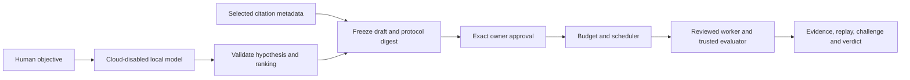

# Athena from source to evidence

Use the [practice workspace](../../learning/README.md) for rebuild exercises. Athena combines a real local model proposal and approved bounded campaign with a synthetic policy study and measured runtime work. The [codebase tour](../../CODEBASE_TOUR.md) shows the order in which to read them.

## 1. Beginner · From objective to a frozen draft

Rust's structs give each part of the input a name and type. Open the [sorting objective](../../taskpacks/athena-sorting-objective.json), then follow `ObjectiveRequest::into_parts` and `PlanningRequest::validate` in [planning.rs](../../crates/aether-api/src/planning.rs). The user supplies an objective, seed, item count and selected references. The model returns a bounded hypothesis and an ordering of reviewed sort enums. It cannot replace those user-supplied parameters.

Read `plan_objective` in [main.rs](../../crates/aether-api/src/main.rs). It locks the draft ID, resolves selected citations with `Lab::freeze_citations` and checks for an identical existing draft. This lets a repeated request reuse its stored proposal. The citations give the reviewer context. The adapter itself receives the objective, seed and item count. `propose_recorded` validates the response. `Lab::create_objective_draft` confirms the advice belongs to that request, picks the first reviewed method and freezes the advice and citation snapshots in `create_frozen`. [Controller](../../crates/aether-api/src/lab.rs)

A digest identifies exact bytes. Changing a seed, model provenance field or selected reference changes the approval digest. See `Lab::approve` and `Lab::run` for the checks before a worker may start. The recorded Athena draft `athena-local-01` contains a real model ranking and an operator-proposed objective. The owner approved its exact digest, after which the frozen task completed with fresh replay and distinct challenge. The trusted evaluator judged the bounded claim from recorded execution evidence. [Frozen draft](../../research/results/athena-local-draft-report.json) · [Approved result](../../research/results/athena-local-campaign.json) · [ADR-013](../decisions/ADR-013.md)

**Exercise.** Write a Rust enum with three allowed candidates and deserialize a ranking in a practice workspace. Test an unknown candidate and a duplicate. Explain why a valid ranking still lacks permission to execute. In a copy of a toy protocol, change one byte and compare the SHA-256 digests.

## 2. Systems practitioner · Local model provenance and GPU measurements

Read `local_server` and `measured_trial` in [athena_ollama.py](../../scripts/athena_ollama.py). The calibration used a temporary Ollama daemon with process-local cloud disabling, a verified installed model manifest and checks for remote routing. In production planning, compare those checks with `OllamaModel::rank` and `ranking` in [providers.rs](../../crates/aether-api/src/planning/providers.rs). The stored proposal records the model name, manifest digest, quantization, prompt digest, parameters and reported token counts.

Quantization represents weights at reduced precision to fit more model parameters in available memory. A model's file size, its loaded GPU residency and device-wide memory use measure different things. Cold start can include model loading. Warm time to first text measures the client wait for a nonempty text chunk with a resident model, and server-side generation throughput divides output token count by generation duration. The initial Athena requests specified different context lengths and both arms reported an effective length of 2,048. The follow-up verified separate 2,048- and 4,096-token resident contexts. Check measured settings before interpreting the differences between two rows. [Inference report and raw data](../operations/ATHENA_INFERENCE.md)

**Exercise.** Compute output tokens per second from one recorded trial using `eval_count / (eval_duration / 1e9)`. Compare that value with output tokens divided by total elapsed seconds. Explain why a cold trial's results differ and why device-wide VRAM is a weaker process-level measure. [Calibration data](../../research/results/athena-ollama-inference.json)

## 3. Systems practitioner · Process handles and containment

A Windows Job Object groups processes so Windows can apply lifetime rules to the group. Trace `supervise_child` in the [runner](../../crates/aether-runner/src/lib.rs) to `spawn` and `wait_for_admission` in [windows_worker.rs](../../crates/aether-runner/src/windows_worker.rs). The reviewed child waits for one byte on its standard input. The parent creates the job, starts that child and attaches it to the job before sending the byte. Failed admission kills and reaps the direct child. Closing the job handle triggers process-tree termination. The worker receives a fixed executable, typed arguments and a cleared inherited environment.

Read `dropping_the_job_stops_a_running_descendant`. Its harmless descendant writes one marker before waiting, then would write a second marker if it survived. The test waits for the first marker and drops the job. A group cleanup test establishes a lifecycle guarantee for this reviewed fixture. Filesystem access, network access, restricted identity and CPU/memory quotas have separate enforcement boundaries. [Threat model](../security/THREAT_MODEL.md)

**Exercise.** Draw a failure trace for an attachment error and a timeout. In each trace mark how the caller knows admission has failed, when the process is reaped and why no result can reach the trusted evaluator. Ask what a child with the current Windows identity can still read.

## 4. Research engineer · Graph priority under controlled evidence

Open `draw` and `run` in [ecar_diagnostics.rs](../../crates/aether-engine/examples/ecar_diagnostics.rs). Keyed draws give each arm the same simulated truth, check noise and worker failures for the same case. Read `schedule_with_trace` in [scheduler.rs](../../crates/aether-engine/src/scheduler.rs) to see where feasibility and ranking enter. In a causal dependency chain, checking a valuable enabling claim can make other claims reachable. Paying for the same prerequisite can waste a scarce budget if it is unreliable. The diagnostic changes graph weight and allocation mode under the same evidence requirements, then reports both useful and harmful cases.

**Exercise.** Sketch a hub with two valuable descendants. Choose a three-action cap. Predict what each policy will prioritize when the hub is reliable and when it is likely false. Verify which event changes eligibility and which term only changes the rank. Compare the valuable-hub and unreliable-hub results. [Development protocol](../research/ATHENA_ECAR_PROTOCOL.md)

## 5. Research engineer · Matched statistics and repeatability

Read `contrast` in [athena_ecar_summary.py](../../scripts/athena_ecar_summary.py). It subtracts arm outcomes within each matched family, seed and cap, averages those differences by seed, then resamples whole seed blocks to preserve the dependence structure. The recorded +0.173-point estimate had a 95% bootstrap interval from −0.840 to +1.188. The interval spans zero, and the result is a synthetic development comparison. Exact replay of the rows checks determinism. Held-out evaluation and claims about actual research performance require separate evidence. [Summary](../../research/results/athena-ecar-summary.json) · [Held-out specification](../../benchmarks/athena-ecar-heldout-spec.json)

**Exercise.** Suppose one seed gives within-pair differences of +3 and +1 points and another gives −2 and 0. Compute each seed mean and the combined mean. Explain why treating the four differences as independent when building an interval would overstate the information in this tiny example.

## 6. Research engineer · Compare equivalent performance workloads

Compare the [Criterion scheduler benchmark](../../crates/aether-engine/benches/scheduler.rs), the `measure` function in the [loopback timing script](../../tests/measure-loopback.cjs) and host scheduler timing in the [ECAR diagnostic](../../crates/aether-engine/examples/ecar_diagnostics.rs). Criterion repeatedly measures a direct function call. The loopback harness warms each route, reads the full response and stores 50 samples per route. Its p95 is the nearest-rank percentile. The diagnostic separately records the time spent calling the scheduler and the simulated cost assigned to actions. These workloads answer different performance questions.

**Exercise.** Use the [recorded loopback samples](../../research/results/athena-loopback-before.json) to compute p50 and p95 after sorting a route's timings. Record the route, sample count, response size and binary digest beside the result. Sketch an equivalent before-and-after run, with unchanged work and test conditions, that could establish whether a targeted code change helped.

**Capstone.** Rebuild a toy planner with two enum candidates, one exact approval digest and one deterministic executor. Include one denied model response, a mismatched approval, one trusted replay and one hypothesis your experiment cannot settle. Explain which observations come from a real process, which rely on a simulator and what evidence would justify promoting a claim.
