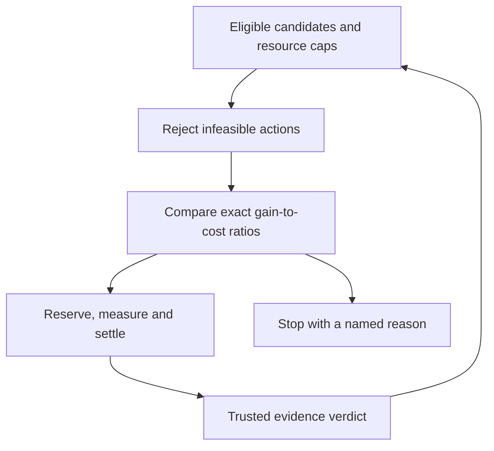

# ECAR mathematics, scientific computing and statistics

Every experiment spends a finite resource. ECAR chooses whether to explore, replay or challenge using estimates of useful information for each eligible action. A separate verifier checks evidence after execution. Scientific computing begins by defining the quantity you can measure and controlling everything else enough to learn from it.

## Read the ranking rule

1. In [`schedule_with_trace`](../../crates/aether-engine/src/scheduler.rs), read cancellation, objective completion and attempt exhaustion checks before ranking. Sort candidate identities and reject duplicates. The original input order has no power over tied actions.
2. Check trusted eligibility and then `Budget::can_reserve` in [budget.rs](../../crates/aether-engine/src/budget.rs). Compute remaining units per cap. For exploration subtract the unconsumed verification floor before comparing the estimate. No addition in one resource can pay for a shortfall in a different resource.
3. In `score`, form gain as expected gain + lambda × uncertainty reduction + mu × claim importance. The default weights are both 1. Pick the maximum share across positive remaining cap dimensions and clamp it from below with a positive epsilon. The largest share identifies the bottleneck.
4. The score is a ratio. `Ratio::compare` first compares integer quotients. If quotients match and both remainders are nonzero, invert the fractions and compare again with reversed ordering. Comparing 7/3 and 9/4 first yields 2 for both and then 1/3 versus 1/4. Comparing their reciprocals gives 3 versus 4, reversing the sign establishes 7/3 > 9/4. This avoids multiplying two potentially large values just to order the scores.
5. Retain the best strictly higher score. On exact equality the stable earlier ID remains. Read the trace for denial, ratio and outcome as stored by [`Lab::run_approved`](../../crates/aether-api/src/lab.rs).

**Worked example.** Remaining capacity is 100 ms, 100 tokens, and 10 attempts. Replay at 30 ms, 20 tokens and one attempt consumes at most 0.30 of a remaining dimension. With weighted gain 14 it ranks as 14/0.30. Exploration at 30 ms, 70 tokens and one attempt consumes at most 0.70. With gain 11 it ranks as 11/0.70. If the unconsumed floor is 25 tokens and the proposal instead needs 90 tokens, it is filtered before ranking. The numbers illustrate the rule.

## Read the matched comparison

In [simulation.rs](../../crates/aether-engine/src/simulation.rs), `simulate` validates a bounded list of seeds and modes, sorts both, then loops over the same cases for each mode. `perform` derives its check result from task, seed, claim and action. A policy making one extra proposal therefore cannot advance a shared random stream and change another policy's check outcome. `independent_verdict` applies shared evidence requirements to all arms.

The native synthetic benchmark checks mechanics. A real pilot estimates variance and calibrates costs using development tasks. A held-out study freezes tasks, evaluator, caps, seed schedule, exclusion rules and analysis before any scores are revealed. Verified utility combines the task score with an independent pass requirement. Include failed and inconclusive outcomes and disclose denominators. Compare D minus B within each task/seed block, average seeds within task, then average across tasks. For uncertainty resample tasks with their seeds together. Shared-task seeds are correlated repeats. See the [statistical plan](../research/STATISTICAL_ANALYSIS_PLAN.md) and [study protocol](../research/EXPERIMENTAL_METHODOLOGY.md).

**Alternative.** A predetermined replay allowance is easier to inspect. A bandit learns which options yield value on repeated comparable tasks, while requiring carefully defined feedback and exploration. Greedy scores are cheap and explainable. They can postpone expensive prerequisites and score correlated checks too highly.

**Exercise.** Choose two actions with the same uncertainty but different wall time and token estimates. Calculate the normalized costs by hand, then move one cap through a boundary until the chosen action changes. State whether the reason is feasibility or rank.

**Interview check.** How does normalizing by wall time and tokens differ from simply adding milliseconds and tokens? Why do independent seeds within one task fail to provide the same statistical information as new tasks? When would a negative paired mean be scientifically informative?

**Debugging challenge.** An experiment demo appears better because the scheduler sees more verification calls in the same numerical cap. Check actual built-in budget reservations, denial reasons and task match before interpreting the aggregate. Run `cargo test --locked -p aether-engine` and find the tied-score and cap-bound cases.

**Rebuild unit.** Write a two-dimensional budget with one protected floor, rank three fixed actions by exact ratios, and print a reason for each denial. Add a paired score table with two tasks and two seeds and compute a task-level mean difference by hand.
