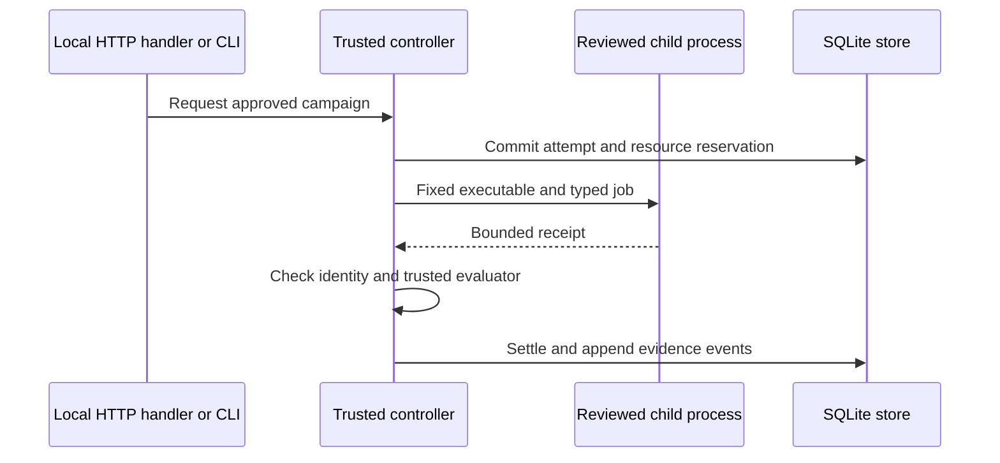

# Processes, concurrency and trustworthy execution

A process is an operating-system unit with an address space and resource handles. A thread is an execution stream inside a process and can share memory with other threads there. AETHER can launch a known worker and collect its observation through a pipe, while the controller keeps decision-making and evidence authority.

## Survey the worker boundary

1. [`supervise`](../../crates/aether-runner/src/lib.rs) validates the enum task and timeout and checks cancellation before launch. The task carries only known options for classification, sorting or search. It serializes a versioned job and creates an isolated working directory for this trusted task.
2. `supervise_child` constructs `Command::new(platform_exe)` with a fixed internal worker flag and bounded JSON arguments. It sets the current directory, clears inherited environment variables and pipes child stdout. Neither user prose nor an adapter result supplies an executable or shell line.
3. The parent starts a bounded reader thread so the child can write while the supervisor polls. The extra byte beyond the configured ceiling distinguishes exactly-at-limit output from oversized output. The loop observes exit, cancellation, or elapsed monotonic time.
4. On failure the supervisor attempts to terminate and reap the child. It joins the reader, checks size and decodes only a versioned receipt with the expected task identity. The built-in worker performs no descendant execution. `execute_worker` and `evaluate` are separate functions to keep measurement and trusted comparison distinct.
5. In [`run_approved`](../../crates/aether-api/src/lab.rs), persist the bounded receipt, result and resource charge transactionally. A cleared environment and fresh directory improve hygiene for this known executable. They do not enforce filesystem, network, privilege, PID or memory isolation for arbitrary code.

## Read the concurrency boundary

The Rust API uses Tokio for concurrent I/O. In [http.rs](../../crates/aether-api/src/http.rs), `blocking` delegates synchronous SQLite operations using `spawn_blocking`. `start` locks a shared active-campaign map, checks one-worker capacity and installs an `Arc<AtomicBool>` cancellation signal before scheduling a blocking job. It drops the map lock before running the job. `cancel` sets the signal; the supervisor checks it as it polls the child. `Arc` allows shared ownership across threads, `Mutex` serializes compound map updates and `AtomicBool` shares one small flag. Durable leases and settlement guard the storage lifetime even when the process exits. See [attempt recovery](IMPLEMENTATION_STORAGE_GRAPHS.md).

**Alternative.** An in-process call is suitable for a pure fixture and easy to test. A reviewed child adds a separate address space, termination facility and process startup cost. Strong isolation for external workers requires a qualified execution profile with independently enforced host access, network policy, resource ceilings and process-tree cleanup. Read the [sandbox design](../security/SANDBOX_DESIGN.md) and [threat model](../security/THREAT_MODEL.md) before extending the boundary.

**Exercise.** Sketch which handle belongs to the supervisor and which belongs to the child. Explain why draining a pipe and waiting on a child can overlap and why cancellation acknowledgement is distinct from terminal state.

**Interview check.** What makes a system call different from an ordinary function? What guarantees does a monotonic clock provide? When would a mutex protect an invariant a single atomic variable cannot encode?

**Debugging challenge.** Trace a pre-cancelled request. Locate the first guard that stops creation of a child. Then use the [runner test suite](../../crates/aether-runner/src/lib.rs) to inspect how a forged or mismatched receipt fails without a trusted metric.

**Rebuild unit.** In a practice workspace, write a supervisor that launches only a built-in child with a fixed flag, sends one bounded value, reads an exact-size reply and reaps on timeout. Use an innocuous sleeping worker for timeout tests and compare wall time with CPU time.
