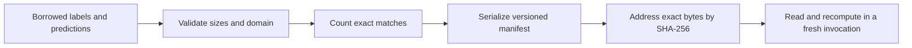

# Rust ownership, memory and exact evaluation

You can evaluate four predictions without training a model. A label is the expected class, a prediction is the proposed class, and accuracy is the fraction of paired values that agree. AETHER keeps the numerator and denominator as integers so equality means exactly the same counts on replay.

## Read the implementation in execution order

| Source anchor | What the expression does |
| --- | --- |
| [core `evaluate`](../../crates/aether-core/src/lib.rs), `labels: &[u8]` | Accept a borrowed slice, which describes a starting location and length. A caller's array or `Vec` remains owned by that caller. A shared reference permits reading and allows other concurrent shared reads. |
| `labels.len() != predictions.len()` | Refuse unpaired values before using `zip`, which would otherwise stop at the shorter input and hide the mismatch. |
| `labels.is_empty()` | Return a typed `EvalError::Empty` so the result never has a zero denominator. |
| `iter().zip(predictions).enumerate()` | Traverse paired references and keep the index. The tuple pattern `(&label, &prediction)` copies each small `u8` value. |
| Domain checks and `correct += 1` | Reject the first invalid value with its index. Increment the stack-local counter only for equal labels and predictions. The loop uses O(n) time and O(1) extra space. |
| `Ok(Accuracy { correct, total: labels.len() })` | Transfer the two counts to the caller by value. The CLI converts to decimal for presentation. |
| [native CLI `run_fixture`](../../crates/aether-cli/src/native.rs) | Collect identity, version, input digest and counts, serialize bytes once, publish the digest-named manifest and then publish the run reference. |
| `read_and_replay` | Validate run and digest reference, recompute SHA-256 over bytes, deserialize, check version and identity, then rerun the exact evaluator and compare pinned inputs plus counts. |

An array stores a fixed count of elements inline. `Vec<T>` owns a dynamically sized allocation and its pointer/length/capacity bookkeeping. A slice borrows an existing contiguous range and carries length without owning the buffer. `'static` in `fixture` describes the lifetime of its immutable literals. `Result<T, E>` makes both normal data and expected failures explicit. A versioned digest measures byte identity. It establishes neither truth nor identity of the party that supplied the bytes.

**Alternative.** Passing owned vectors would force a move or clone at the call site. A floating-point return would erase denominator information needed to distinguish 3/4 and 6/8. A trait abstraction could support multiple scorers later when their metric and input contracts justify it. The first evaluator keeps one narrow function.

**Exercise.** Count 0, 1, 1, 0 versus 0, 1, 0, 0 by hand. Then use the [practice workspace](../../learning/README.md) to implement a `matches(labels: &[u8], predictions: &[u8])` function with one test for each typed failure. Run `cargo test --locked -p aether-core` to compare the production contract.

**Interview check.** Explain why `Vec<u8>` and `&[u8]` pose different ownership requirements. When does cloning become observable for big inputs? Why would counting only matching zipped pairs produce a misleading score for mismatched lengths?

**Debugging challenge.** A manifest was saved with its expected digest, then a text editor added a newline. Predict which check fails before replay starts. Write a test with two distinct serializations measuring byte identity and compare the parsed values.

**Rebuild unit.** Create a small binary that reads fixed arrays, emits exact counts and saves a two-field manifest. Add a verifier that accepts expected bytes or a digest and fails on any mismatch. Explain when a trusted expected digest is needed.
