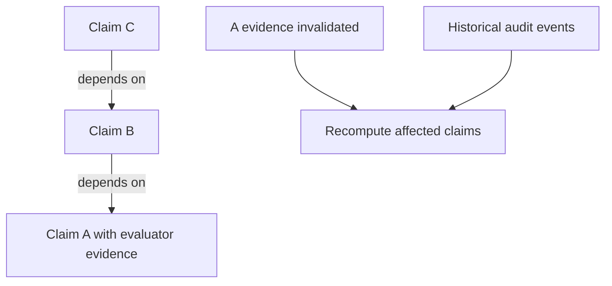

# SQLite transactions, evidence and dependency graphs

An attempt can produce a metric, an artifact and a resource charge. A transaction changes all related rows together, so a restart sees a complete change or the prior state. A dependency graph records scientific prerequisites. Follow edges from a dependent claim to the claims it relies on.

## Read admission and settlement line by line

1. Start in [Store open/write](../../crates/aether-store/src/lib.rs). SQLite keeps the campaign, dependency, attempt, artifact and event rows. The Rust adapter confines mutation to transactions and binds values as SQL parameters.
2. In [`start_attempt_with_reserve`](../../crates/aether-store/src/execution.rs), validate the attempt identity, one attempt unit and a future expiration. Check the running campaign and run status.
3. Read committed counters in the same transaction. Add the estimate to reserved and add the protected floor to the admission test. Reject overflow, an exceeded vector cap or a halted campaign.
4. Insert the attempt and update the budget and event log. If any operation fails, the transaction rolls back the reserve and attempt together.
5. In `complete_attempt`, validate; compute manifest and completion digests; check the lease; then accept an identical digest as an idempotent retry. Reject a different result for the same completed lease or a late result from an expired lease.
6. Commit metrics, artifact blobs, outcome, usage and audit events together. Inspect `recover_expired` to see how elapsed leases get an explicit conservative settlement instead of disappearing.

## Read the graph operations line by line

In [`add_dependency`](../../crates/aether-store/src/evidence.rs), check both claims' campaign IDs. A recursive query starts from the proposed prerequisite and follows its existing prerequisites. If it reaches the proposed dependent, the new edge creates a cycle and is rejected. Storing the edge, appending its event and updating current verdicts happen in one write. In `revoke`, traverse the opposite direction to find all impacted dependents. The recursive query uses a set of IDs so a shared path can reach the same claim without giving it multiple state changes.

The data model separates artifact identity (hash), artifact use by an attempt, metric identity, evidence relation and verifier verdict. See `eligible_support` for the prerequisite and provenance checks. A valid output can become supporting evidence when linked. Required replication and any campaign-specific challenge rules still determine whether the final verdict may be verified. Evidence invalidation appends history and changes the current projection.

**Alternative.** A JSON file works for the native fixture and content digests catch damage. SQLite makes multi-record commitments and recovery easier to reason about. A graph database could make richer graph queries convenient, while introducing a second synchronization boundary if the budget ledger stayed in SQLite. An in-memory depth-first traversal is a useful first model of the recursive query.

**Exercise.** Draw a diamond where B and C require A and D requires B and C. Try to add A requiring D. Predict which recursive query rows reveal the cycle, then reason about all four verdicts when A loses required evidence.

**Interview check.** Define atomicity, referential integrity and idempotence. Can an identical HTTP retry repeat an operation safely if the SQL only has a unique ID and fails on conflict? How can a completion digest strengthen that decision?

**Debugging challenge.** A worker produces a valid outcome after its lease expired. Identify the store check that must reject it. Test reading events after expiry and ensure the stale completion creates no metrics. See [store tests](../../crates/aether-store/src/tests.rs).

**Rebuild unit.** Model three claims in a map from IDs to prerequisites. Write a visited-set traversal to reject cycles and a reverse traversal for revocation. Then add a three-table SQLite exercise with a transaction that inserts one attempt, reserves credits and appends one event, including a rollback test.
